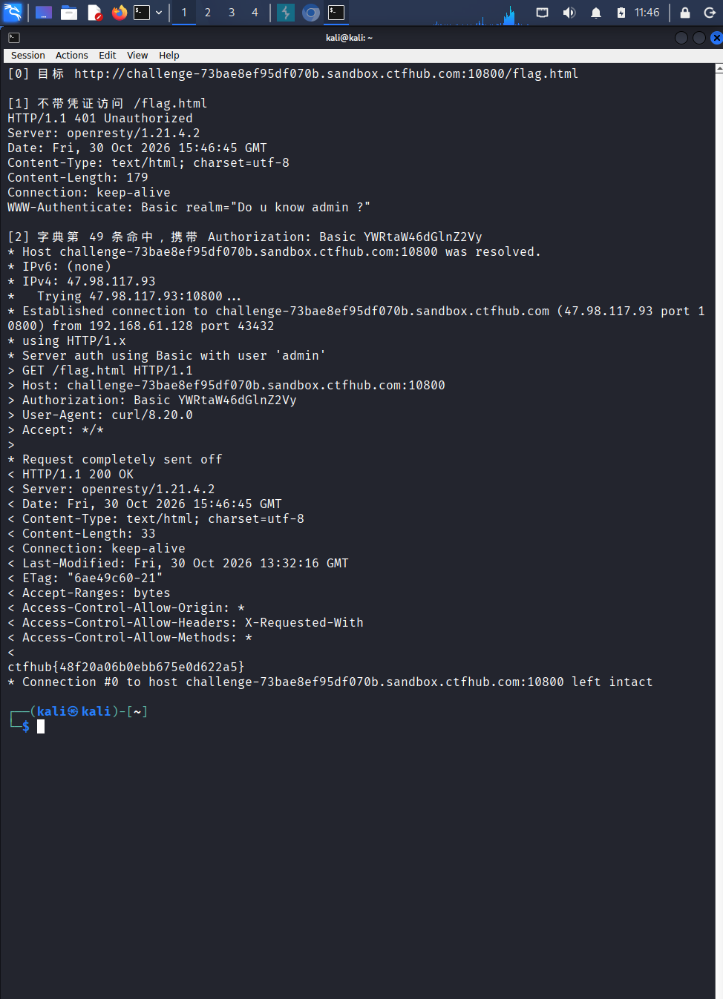

# WP：基础认证

> **CTFHub 路径**：技能树 → Web → Web 前置技能 → HTTP 协议 → 基础认证
> **任务**：按题目提示完成 HTTP Basic 认证，拿到 flag。
> **提示**：观察 `401 Unauthorized` 响应和 `WWW-Authenticate: Basic` 响应头。Basic 认证把 `用户名:密码` 做 Base64 编码后放在 `Authorization` 请求头里，Base64 不是加密。
> **截图要求**：能看到 `Authorization: Basic ...` 请求头，以及认证成功后的 flag 或页面。

---

## 题目信息

| 项目 | 内容 |
| --- | --- |
| 环境地址 | http://challenge-73bae8ef95df070b.sandbox.ctfhub.com:10800 |
| Flag | ctfhub{48f20a06b0ebb675e0d622a5} |

## 解题过程

第一次访问靶场，浏览器直接弹出登录框，在终端 `curl -i <环境地址>/` 能看到 `HTTP/1.1 401 Unauthorized` 和 `WWW-Authenticate: Basic realm="..."`，说明这是 HTTP 基础认证，用户名就是提示里的 `admin`。题目页面下方提供了密码字典，我下载到 Kali 后，用 curl 循环把字典里每个密码都和 `admin` 组合发一次请求，每次只看返回码：401 是密码错，200 就是命中。找到正确密码后，用 `curl -i -u admin:tigger <环境地址>/flag.html` 正式访问，响应体里拿到 `ctfhub{48f20a06b0ebb675e0d622a5}`，提交后提示正确。之后我又把 `admin:tigger` 做了一次 Base64 编码，和请求头里的值对比，确认完全一致，也验证了“Basic 认证就是把凭据 Base64 一下”。

## 关键请求/响应

```http
--- 1. 无凭据 ---
GET / HTTP/1.1
Host: challenge-73bae8ef95df070b.sandbox.ctfhub.com:10800

HTTP/1.1 401 Unauthorized
WWW-Authenticate: Basic realm="..."

--- 2. 带正确凭据 ---
GET /index.php HTTP/1.1
Host: challenge-73bae8ef95df070b.sandbox.ctfhub.com:10800
Authorization: Basic YWRtaW46dGlnZ2Vy

HTTP/1.1 200 OK
Content-Type: text/html; charset=UTF-8

...(页面内容) ctfhub{48f20a06b0ebb675e0d622a5}
```

## 原理与复盘

Base64 **不是加密**，它只是一种把二进制数据映射成可打印字符的编码方式，没有密钥，任何人拿到都能一键还原（`echo -n 'admin:123456' | base64` 与 `base64 -d` 可互相转换）。Basic 认证的 `Authorization` 请求头里实际放的是 `Basic ` + `base64(用户名:密码)`，也就是说**密码等于以明文随每次请求发送**，抓包或中间人一旦拿到就能直接解出账号密码（本题正是靠字典逐个尝试 Base64 头把弱口令试出来的）。所以 Basic 认证必须配合 HTTPS 使用，且密码要足够强；它只解决"把凭据怎么携带"的问题，不提供任何加密保护。

---

## 截图



> 可以在这份 WP 中另加过程截图；检查时只看指定图片，额外图片不检查。

