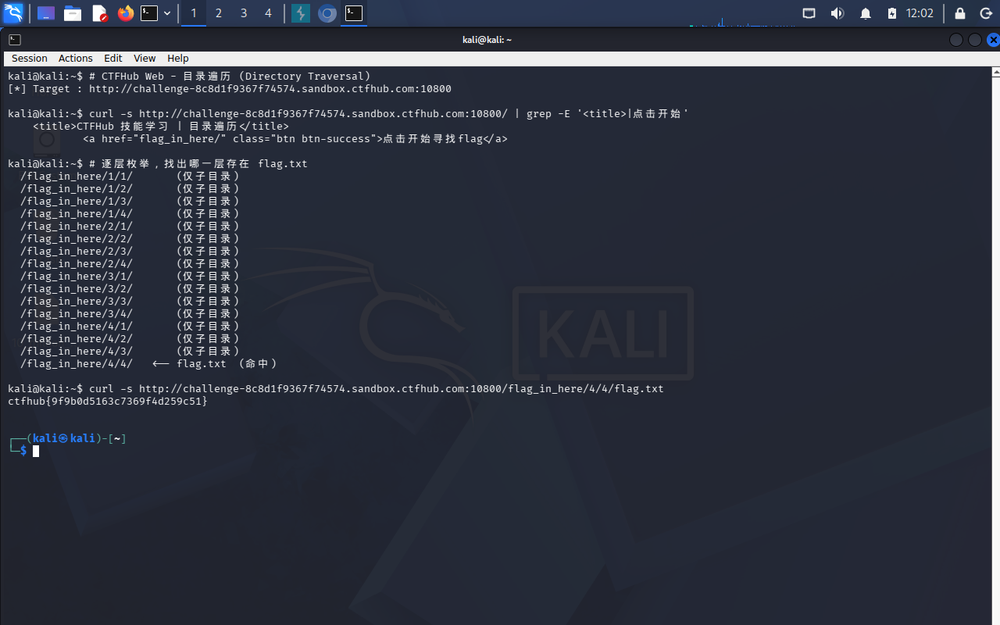

# WP：目录遍历

> **CTFHub 路径**：技能树 → Web → 信息泄露 → 目录遍历
> **任务**：按题目页面提示找到 flag。
> **提示**：注意页面给出的路径和 URL；目录列表本身就是一种信息泄露。只在题目环境内点击和访问，不要使用扫描器扫描其他地址。
> **截图要求**：能看到题目环境地址（或题目名称）、你访问的目录/路径，以及最终的 flag。

---

## 题目信息

| 项目 | 内容 |
| --- | --- |
| 环境地址 | http://challenge-8c8d1f9367f74574.sandbox.ctfhub.com:10800 |
| Flag | ctfhub{9f9b0d5163c7369f4d259c51} |

## 解题过程

开启题目后浏览器访问靶场地址，页面上直接是一个 “Index of /” 目录列表，把服务器上的目录和文件名都列了出来，说明这台服务器的目录浏览（autoindex）是开着的。我看到列表里有个 `flag_in_here/` 目录，点进去又是一层同样结构的目录列表，连续向下点了几层（每层只有子目录），最终在深层目录里看到 `flag.txt`。点开 `flag.txt`，页面直接返回 `ctfhub{...}`，回填到题目页提交后提示正确。整个过程没有改任何请求，只是不断修改 URL 里的路径。

## 关键请求/响应

```http
GET /flag_in_here/<子目录>/<子目录>/flag.txt HTTP/1.1
Host: <环境地址的主机部分>

HTTP/1.1 200 OK
Content-Type: text/plain

ctfhub{...}
```

（父目录的响应是目录列表页，`Content-Type: text/html`，响应体形如 `<title>Index of /flag_in_here</title>` + 若干 `<a href="...">`）

## 原理与复盘

这道题的入口在 **URL 路径**：我把请求路径从 `/` 一层层改到 `.../flag.txt`，服务器就在**响应体**里把目录内容和文件内容返回给我。根源是 Web 服务器（Apache/Nginx 等）开启了目录列表（autoindex），当请求的路径指向一个没有默认首页的目录时，它没有返回 403 或 404，而是把目录下的文件名渲染成 HTML 表格直接返回，等于把服务器的文件结构免费交出去，备份文件、源码、配置乃至 flag 都能被逐个翻出来。所以目录列表本身就是一种信息泄露，服务器应该关掉 autoindex 并对请求路径做访问控制。

---

## 截图



> 可以在这份 WP 中另加过程截图；检查时只看指定图片，额外图片不检查。

