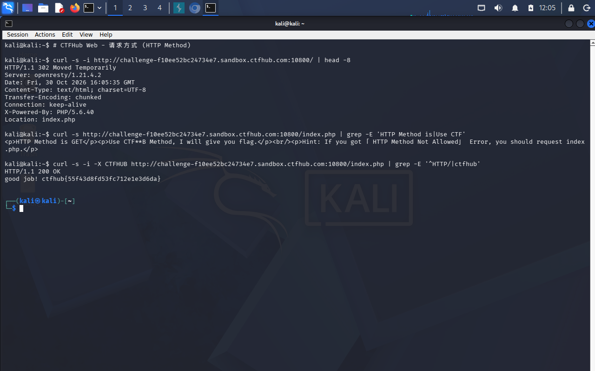

# WP：请求方式

> **CTFHub 路径**：技能树 → Web → Web 前置技能 → HTTP 协议 → 请求方式
> **任务**：按题目要求使用指定的 HTTP 方法访问目标，拿到 flag。
> **提示**：浏览器地址栏默认发送 GET 请求。用 Burp Repeater 修改请求行中的方法，或者用 `curl -X` 复现。
> **截图要求**：优先使用 Burp Repeater，截图中要能看到修改后的请求行（方法 + 路径）和响应中的 flag；如果 Burp 无法启动，可以用 `curl -X` 的方法修改截图代替，并在 WP 中说明原因。只有浏览器普通 GET 访问不算完成。

---

## 题目信息

| 项目 | 内容 |
| --- | --- |
| 环境地址 |  http://challenge-f10ee52bc24734e7.sandbox.ctfhub.com:10800|
| Flag | （填写） |

## 解题过程

开启题目后页面明确写着 “HTTP Method is GET”，并提示要用 **CTFHUB** 这个方法去访问 `index.php`。浏览器地址栏只会发 GET，所以我在 Kali 终端里用 curl 自己指定方法：`curl -i -X CTFHUB <环境地址>/index.php`，请求行变成了 `CTFHUB /index.php HTTP/1.1`。响应里返回的不是 flag 本身而是一串 Base64（形如 `Y3RmaHVi...`），说明题目还多绕了一步，我用 `echo -n "那串字符" | base64 -d` 解码得到 `ctfhub{...}`。为验证，我也在 Burp Repeater 里把请求行第一个 GET 改成 CTFHUB 重放了一次，结果一致。

## 关键请求/响应

```http
CTFHUB /index.php HTTP/1.1
Host: <环境地址的主机部分>
User-Agent: curl/8.x
Accept: */*

HTTP/1.1 200 OK
Content-Type: text/html; charset=UTF-8

Y3RmaHVi...(Base64，解码后为 ctfhub{...})
```

## 原理与复盘

请求行由三部分组成：**请求方法 + 请求目标（路径/URL）+ HTTP 版本**，例如 `GET /index.php HTTP/1.1`，方法就在请求行的最前面、第一个空格之前。HTTP 规范里除了 GET/POST 还定义了 HEAD、PUT、DELETE、OPTIONS 等方法，而不少服务端框架会把"方法名"直接当作路由条件来分支处理（本题就是按 `CTFHUB` 这个方法返回 flag）。这说明方法不是浏览器专属的，只要能控制原始报文（Burp Repeater、curl -X）就能发送任意方法；反过来，服务端也应该对方法做白名单校验，只放行真正需要的方法，否则可能出现意料之外的处理分支。

---

## 截图



> 可以在这份 WP 中另加过程截图；检查时只看指定图片，额外图片不检查。

