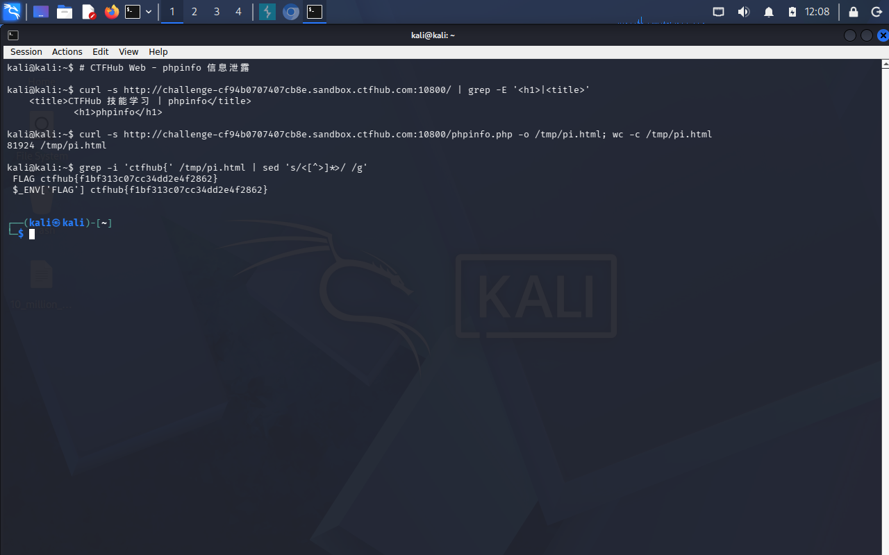

# WP：PHPINFO

> **CTFHub 路径**：技能树 → Web → 信息泄露 → PHPINFO
> **任务**：在 phpinfo 页面中找到 flag，并观察它泄露了哪些信息。
> **提示**：phpinfo 会输出大量 PHP 和服务器配置。用浏览器的查找功能搜索关键字，同时留意页面暴露的路径、版本、环境变量等信息。
> **截图要求**：能看到 phpinfo 页面、你搜索/定位到的 flag，以及至少一处敏感信息。

---

## 题目信息

| 项目 | 内容 |
| --- | --- |
| 环境地址 | http://challenge-cf94b0707407cb8e.sandbox.ctfhub.com:10800 |
| Flag | ctfhub{f1bf313c07cc34dd2e4f2862} |

## 解题过程

开启题目后访问靶场地址，浏览器直接渲染出一个完整的 phpinfo 页面（蓝紫色表格，分 General、PHP Variables 等区块），没有任何登录或跳转。我先按 `Ctrl + F` 搜索 `flag`，在环境变量区块里找到一行 `_ENV["FLAG"]`，值就是 `ctfhub{f1bf313c07cc34dd2e4f2862}`，直接就在页面上（用 `curl -s <环境地址>/phpinfo.php | grep -i ctfhub` 也能一行取到）。除了 flag，页面还暴露了大量配置信息：PHP 版本号、`DOCUMENT_ROOT`（网站根目录的绝对路径）、`SERVER_SOFTWARE`（Web 服务器类型和版本）、以及环境变量和 `$_SERVER` 里的请求细节。把 flag 提交后提示正确。

## 关键请求/响应

```http
GET / HTTP/1.1
Host: challenge-cf94b0707407cb8e.sandbox.ctfhub.com:10800

HTTP/1.1 200 OK
Content-Type: text/html; charset=UTF-8

<tr><td class="e">_ENV["FLAG"]</td><td class="v">ctfhub{f1bf313c07cc34dd2e4f2862}</td></tr>
<tr><td class="e">PHP Version </td><td class="v">7.x.x</td></tr>
<tr><td class="e">DOCUMENT_ROOT </td><td class="v">/var/www/html</td></tr>
```

（实际版本号和路径以我看到的页面为准；`curl -s <环境地址> | grep -i -A1 flag` 也能直接取到这一行）

## 原理与复盘

phpinfo 是 PHP 自带的调试页面，它把一整份运行时配置渲染在**响应体**里：PHP 版本与编译参数、`DOCUMENT_ROOT`（网站绝对路径）、`SERVER_SOFTWARE`、加载的扩展、以及环境变量和 `$_SERVER` 里的请求信息。对攻击者来说这是一张"服务器体检报告"：知道版本就能对上已知 CVE，知道绝对路径就能算准文件包含、日志写入的落点，知道扩展和配置就能判断哪些危险函数可用（如 `allow_url_include`）。所以生产环境必须禁止 phpinfo 页面被外网访问，本题目的是让大家直观看到"一个调试页面能泄露多少东西"。

---

## 截图



> 可以在这份 WP 中另加过程截图；检查时只看指定图片，额外图片不检查。

