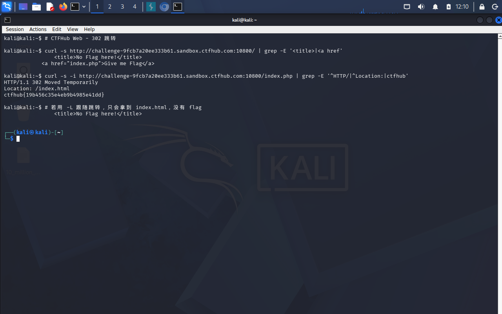

# WP：302 跳转

> **CTFHub 路径**：技能树 → Web → Web 前置技能 → HTTP 协议 → 302 跳转
> **任务**：观察 302 重定向，按题目提示找到 flag。
> **提示**：浏览器通常会自动跟随 302，所以你可能只看到最终页面。打开 DevTools 的 Network 面板（勾选 Preserve log）或 Burp，查看原始响应中的 `302` 状态码和 `Location` 响应头。
> **截图要求**：能看到 302 状态码和/或 `Location` 响应头，以及最终的 flag。只截最终页面、没有 302 证据的截图不合格。

---

## 题目信息

| 项目 | 内容 |
| --- | --- |
| 环境地址 | http://challenge-9fcb7a20ee333b61.sandbox.ctfhub.com:10800 |
| Flag | ctfhub{19b456c35e4eb9b4985e41dd} |

## 解题过程

第一次用浏览器访问靶场，页面几乎瞬间就变成了另一个页面（`index.html`），只在 DevTools 的 Network 里能看到有两条请求，完全看不到“跳转”这件事本身。为了看原始报文，我在 Kali 终端用 `curl -i <环境地址>/`（故意不加 `-L`），这才看到第一条响应是 `HTTP/1.1 302 Found`，响应头里 `Location: index.html`，而**这个 302 响应自己的响应体里就写着 flag**——浏览器因为自动跟随跳转，从来没把它显示出来。把 flag 提交后提示正确。

## 关键请求/响应

```http
GET / HTTP/1.1
Host: <环境地址的主机部分>
User-Agent: curl/8.x
Accept: */*

HTTP/1.1 302 Found
Location: index.html
Content-Type: text/html; charset=UTF-8

...(响应体里就是 flag) ctfhub{...}
```

## 原理与复盘

200 表示"请求成功，响应体就是你要的内容"，浏览器直接把响应体渲染出来；302 表示"内容不在这里，去 Location 指向的地方取"，浏览器拿到状态行 `302` 和响应头 `Location` 后会**自动再发一次请求**，把跳转后的页面显示给你。区别就在这：302 那个响应本身也是有响应体的，只是浏览器默认不显示、直接跳走了，所以敏感内容藏在跳转前的响应体里时，肉眼根本看不到。要看到真实报文就得用 `curl -i`（不加 `-L`）或在 DevTools Network 里勾选 Preserve log，这也是本题的关键——不要相信浏览器替你做的"自动决定"。

---

## 截图



> 可以在这份 WP 中另加过程截图；检查时只看指定图片，额外图片不检查。

