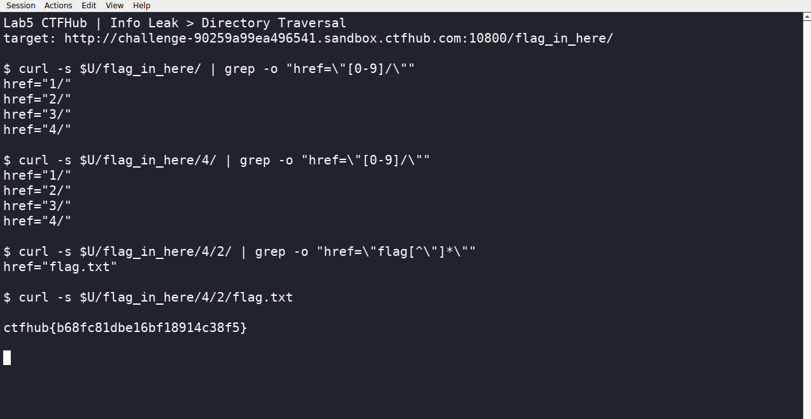

# WP：目录遍历

> **CTFHub 路径**：技能树 → Web → 信息泄露 → 目录遍历
> **任务**：按题目页面提示找到 flag。
> **提示**：注意页面给出的路径和 URL；目录列表本身就是一种信息泄露。只在题目环境内点击和访问，不要使用扫描器扫描其他地址。
> **截图要求**：能看到题目环境地址（或题目名称）、你访问的目录/路径，以及最终的 flag。

---

## 题目信息

| 项目 | 内容 |
| --- | --- |
| 环境地址 | http://challenge-90259a99ea496541.sandbox.ctfhub.com:10800 |
| Flag | ctfhub{b68fc81dbe16bf18914c38f5} |

## 解题过程

靶场首页只有一句提示和一个按钮“点击开始寻找flag”，点进去的地址是 `/flag_in_here/`，返回的不是网页而是 Apache 的目录索引，直接列出 `1/ 2/ 3/ 4/` 四个目录。

我顺着点进第 1 个目录，看到的还是一模一样的四个数字目录，说明这是多层嵌套的同构结构，靠手点会点很久。于是我在 Kali 里用 curl 按目录列表里的链接一层层往下抓，每进一层就把 `href` 里的子目录取出来继续访问，到 `/flag_in_here/4/2/` 这一层时，列表里出现了 `flag.txt`，直接访问它就拿到了 flag。

整个过程只访问了题目环境内部的路径，没有用扫描器去跑别的主机。第一次能一眼看出结构，靠的就是服务器把目录内容列了出来。

## 关键请求/响应

```http
GET /flag_in_here/ HTTP/1.1
Host: challenge-90259a99ea496541.sandbox.ctfhub.com:10800

HTTP/1.1 200 OK

href="1/"  href="2/"  href="3/"  href="4/"

---

GET /flag_in_here/4/2/flag.txt HTTP/1.1
Host: challenge-90259a99ea496541.sandbox.ctfhub.com:10800

HTTP/1.1 200 OK

ctfhub{b68fc81dbe16bf18914c38f5}
```

## 原理与复盘

这道题落在 HTTP 报文的请求行里：变的只有请求目标（URL 路径），`/flag_in_here/4/2/flag.txt` 就是我一步步拼出来的路径，请求头和响应头都没动过。目录列表之所以危险，是因为服务器开了 autoindex，把目录下所有文件名直接告诉访问者，攻击者不用猜就能看到备份文件、`.git`、配置文件或源码，相当于把“有什么可拿”提前列成了清单。

---

## 截图



> 可以在这份 WP 中另加过程截图；检查时只看指定图片，额外图片不检查。
