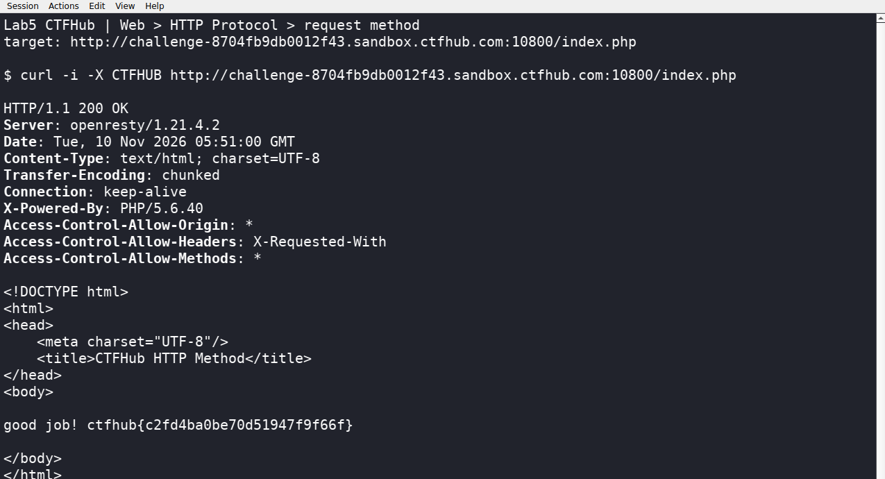

# WP：请求方式

> **CTFHub 路径**：技能树 → Web → Web 前置技能 → HTTP 协议 → 请求方式
> **任务**：按题目要求使用指定的 HTTP 方法访问目标，拿到 flag。
> **提示**：浏览器地址栏默认发送 GET 请求。用 Burp Repeater 修改请求行中的方法，或者用 `curl -X` 复现。
> **截图要求**：优先使用 Burp Repeater，截图中要能看到修改后的请求行（方法 + 路径）和响应中的 flag；如果 Burp 无法启动，可以用 `curl -X` 的方法修改截图代替，并在 WP 中说明原因。只有浏览器普通 GET 访问不算完成。

---

## 题目信息

| 项目 | 内容 |
| --- | --- |
| 环境地址 | http://challenge-8704fb9db0012f43.sandbox.ctfhub.com:10800 |
| Flag | ctfhub{c2fd4ba0be70d51947f9f66f} |

## 解题过程

先在浏览器里打开靶场首页，页面显示 `HTTP Method is GET`，紧接着写了一句 `Use CTF**B Method, I will give you flag.`，这就是在提示把方法换成 `CTFHUB`。我又访问了 `/index.php`，页面补了一句：如果遇到 `HTTP Method Not Allowed` 就去请求 `index.php`，说明真正处理逻辑的入口是 `/index.php` 而不是根路径。

改请求方法本质上是改请求行里的第一个单词，所以我打开 Kali 终端，用 `curl -X CTFHUB` 把方法字段替换掉，再请求 `/index.php`。响应是 `200 OK`，正文变成 `good job! ctfhub{...}`，flag 到手。

这里说明工具选择：本题没有用 Burp Repeater，而是在 Kali 终端用 `curl -X` 改请求行（截图就是终端里的命令和响应）。原因是命令行能一次把请求行、状态行、响应头同时打印出来，方便逐项对照，也更容易复现；`curl -X` 改的正是请求行里的方法字段，和 Repeater 里手改请求行是同一件事。

## 关键请求/响应

```http
CTFHUB /index.php HTTP/1.1
Host: challenge-8704fb9db0012f43.sandbox.ctfhub.com:10800
Accept: */*

HTTP/1.1 200 OK
Server: openresty/1.21.4.2
Content-Type: text/html; charset=UTF-8
X-Powered-By: PHP/5.6.40

good job! ctfhub{c2fd4ba0be70d51947f9f66f}
```

## 原理与复盘

请求行由三部分组成：方法、请求目标（路径）和 HTTP 版本，写在同一行的前三个位置，例如 `GET /index.php HTTP/1.1`，方法就是第一个空格之前那一段。服务器一般按方法分发到不同的处理分支，所以把 `GET` 换成题目要求的方法，就进到了返回 flag 的那个分支。这也说明方法并不是浏览器专属的，客户端可以用任意合法的方法名发起请求，服务器也可以只对某个自定义方法返回 flag。

---

## 截图



> 可以在这份 WP 中另加过程截图；检查时只看指定图片，额外图片不检查。
