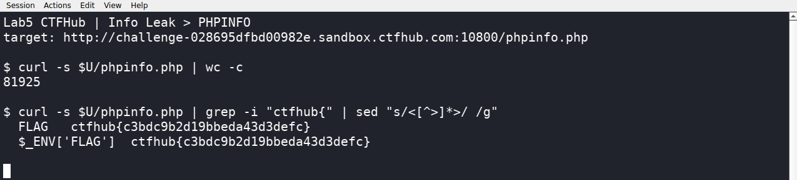

# WP：PHPINFO

> **CTFHub 路径**：技能树 → Web → 信息泄露 → PHPINFO
> **任务**：在 phpinfo 页面中找到 flag，并观察它泄露了哪些信息。
> **提示**：phpinfo 会输出大量 PHP 和服务器配置。用浏览器的查找功能搜索关键字，同时留意页面暴露的路径、版本、环境变量等信息。
> **截图要求**：能看到 phpinfo 页面、你搜索/定位到的 flag，以及至少一处敏感信息。

---

## 题目信息

| 项目 | 内容 |
| --- | --- |
| 环境地址 | http://challenge-028695dfbd00982e.sandbox.ctfhub.com:10800/phpinfo.php |
| Flag | ctfhub{c3bdc9b2d19bbeda43d3defc} |

## 解题过程

靶场首页只有一个按钮“点击查看phpinfo”，点进去是 `/phpinfo.php`，一屏拉不到底的配置输出。我先用 `curl -s` 把整个页面抓下来看大小，有 8 万多字节，说明 phpinfo 把 PHP 版本、编译参数、模块、服务器变量、环境变量全都打印出来了。

这么大的页面靠眼睛翻不现实，所以我直接在 Kali 终端里用 `grep -i "ctfhub{"` 过滤，只命中两行：一行标题是 `FLAG`，另一行是 `$_ENV['FLAG']`，两个值都是同一个 flag。也就是说 flag 是被放进环境变量里，再由 phpinfo 原样打印出来的。浏览器里按 `Ctrl + F` 搜 `FLAG` 或 `ctfhub` 也能同样定位。

顺带记录页面暴露的其他敏感信息：`Server`、`X-Powered-By` 能看出服务端用的是 openresty + PHP/5.6.40（一个早就不维护的版本），phpinfo 里还有 `DOCUMENT_ROOT` 这类绝对路径和大量模块配置，对攻击者来说都是现成的情报。

## 关键请求/响应

```http
GET /phpinfo.php HTTP/1.1
Host: challenge-028695dfbd00982e.sandbox.ctfhub.com:10800

HTTP/1.1 200 OK
Server: openresty/1.21.4.2
X-Powered-By: PHP/5.6.40
Content-Type: text/html; charset=UTF-8

FLAG                ctfhub{c3bdc9b2d19bbeda43d3defc}
$_ENV['FLAG']       ctfhub{c3bdc9b2d19bbeda43d3defc}
```

## 原理与复盘

phpinfo 是 PHP 自带的调试页面，会输出 PHP 版本与编译参数、已加载模块、`DOCUMENT_ROOT` 等绝对路径、环境变量、HTTP 头等一整套配置。这些信息本身不“执行”任何攻击，但能帮攻击者判断有哪些已知漏洞可用、网站根目录在哪、有没有把密钥或数据库口令写进环境变量，属于典型的低门槛信息泄露，生产环境应当删除或限制访问。这题对应 HTTP 报文里的响应体：flag 就是被当成普通页面内容输出出来的。

---

## 截图



> 可以在这份 WP 中另加过程截图；检查时只看指定图片，额外图片不检查。
