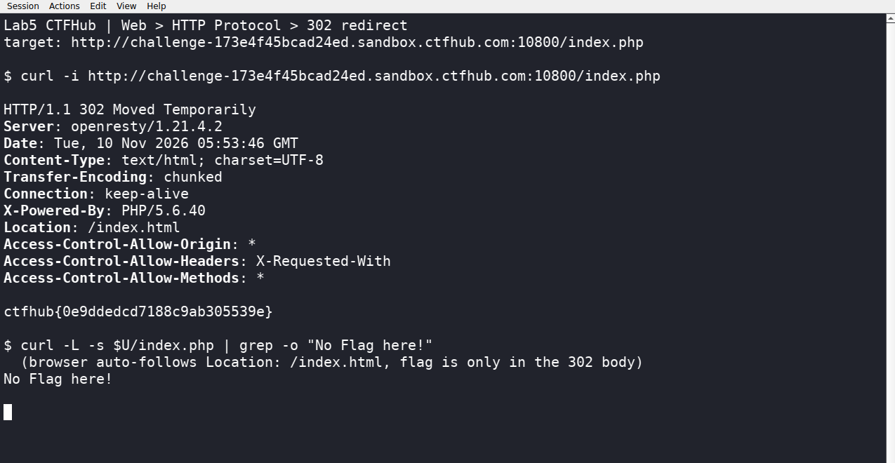

# WP：302 跳转

> **CTFHub 路径**：技能树 → Web → Web 前置技能 → HTTP 协议 → 302 跳转
> **任务**：观察 302 重定向，按题目提示找到 flag。
> **提示**：浏览器通常会自动跟随 302，所以你可能只看到最终页面。打开 DevTools 的 Network 面板（勾选 Preserve log）或 Burp，查看原始响应中的 `302` 状态码和 `Location` 响应头。
> **截图要求**：能看到 302 状态码和/或 `Location` 响应头，以及最终的 flag。只截最终页面、没有 302 证据的截图不合格。

---

## 题目信息

| 项目 | 内容 |
| --- | --- |
| 环境地址 | http://challenge-173e4f45bcad24ed.sandbox.ctfhub.com:10800 |
| Flag | ctfhub{0e9ddedcd7188c9ab305539e} |

## 解题过程

第一次在浏览器里打开靶场根路径，看到的是一张写着 `No Flag here!` 的静态页，没有任何 flag，看上去像是走错了。于是我把地址换成 `/index.php`，用 `curl -i` 直接看原始响应，这才看到状态行是 `302 Moved Temporarily`，响应头里有 `Location: /index.html`，而 302 这一次响应的正文里就是 flag。

浏览器遇到 302 会自动按 `Location` 再发一次请求，所以我平时在地址栏里只能看到最终那个 `No Flag here!` 页面，第一次响应的正文被“跳过”了。我特意又跑了一次 `curl -L` 让它跟着跳转，结果确实只剩 `No Flag here!`，反过来说明 flag 只存在于 302 那次响应里。

所以这题的关键不是“点进去”，而是把自动跟随关掉（curl 不加 `-L`，或者 DevTools 的 Network 里勾 Preserve log），去看第一跳的原始响应。

## 关键请求/响应

```http
GET /index.php HTTP/1.1
Host: challenge-173e4f45bcad24ed.sandbox.ctfhub.com:10800

HTTP/1.1 302 Moved Temporarily
Server: openresty/1.21.4.2
Content-Type: text/html; charset=UTF-8
Location: /index.html
X-Powered-By: PHP/5.6.40

ctfhub{0e9ddedcd7188c9ab305539e}
```

## 原理与复盘

`200` 表示这次请求成功，浏览器直接把响应体渲染出来；`302` 只表示“资源临时搬到别处”，浏览器会读 `Location` 再发起一次新请求，用户看到的是第二次请求的结果。所以调查重定向必须看原始响应（`curl -i` 不加 `-L`，或 DevTools 勾 Preserve log），否则第一跳的响应头、响应体都会被后一跳覆盖掉。

---

## 截图



> 可以在这份 WP 中另加过程截图；检查时只看指定图片，额外图片不检查。
