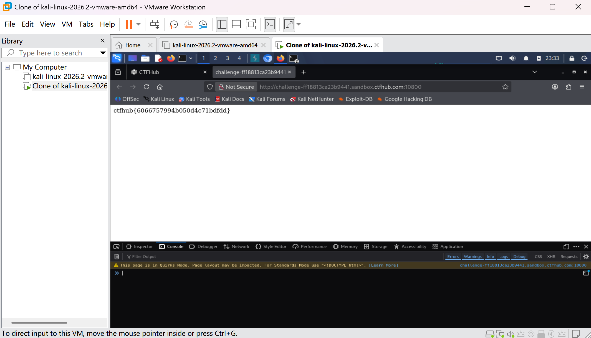

# WP：Cookie

> **CTFHub 路径**：技能树 → Web → Web 前置技能 → HTTP 协议 → Cookie
> **任务**：按题目提示修改 Cookie，拿到 flag。
> **提示**：在 DevTools 的 Application/Storage → Cookies 中查看 Cookie，或在 Burp 的请求头中查看。修改后重放请求，观察页面变化。
> **截图要求**：能看到修改后的 Cookie 请求头，以及服务器返回的 flag 或成功页面。

---

## 题目信息

| 项目 | 内容 |
| --- | --- |
| 环境地址 | http://challenge-ff18813ca23b9441.sandbox.ctfhub.com:10800/ |
| Flag | ctfhub{6066757994b050d4c71bdfdd} |

## 解题过程

打开题目是一个登录页，提示只有管理员才能看到 flag。在 Firefox 的 DevTools 存储 → Cookie 里可以看到本站下发了 admin=0，说明服务器用这个值判断当前用户是不是管理员。我把它的值改成 admin=1 后刷新页面，服务器就认为我是管理员，直接把 flag 显示出来。在 Application 面板确认改动生效后，页面返回的就是 ctfhub{...}。

## 关键请求/响应

```http
GET / HTTP/1.1
Host: challenge-ff18813ca23b9441.sandbox.ctfhub.com:10800
Cookie: admin=1

HTTP/1.1 200 OK
Content-Type: text/html; charset=utf-8

ctfhub{6066757994b050d4c71bdfdd}
```

## 原理与复盘

Cookie 是放在 HTTP 请求头里随每次请求一起发送的，服务器读到之后才知道"这个请求是谁发的"。如果服务端直接相信客户端传来的 Cookie 值来做权限判断，既不签名也不做服务端会话校验，那么改一个数字就能把自己从普通用户提升成管理员，属于典型的越权。

---

## 截图



> 可以在这份 WP 中另加过程截图；检查时只看指定图片，额外图片不检查。
