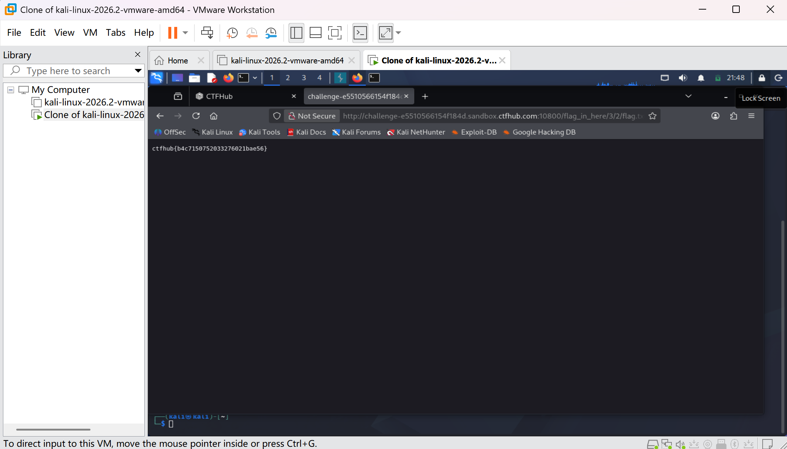

# WP：目录遍历

> **CTFHub 路径**：技能树 → Web → 信息泄露 → 目录遍历
> **任务**：按题目页面提示找到 flag。
> **提示**：注意页面给出的路径和 URL；目录列表本身就是一种信息泄露。只在题目环境内点击和访问，不要使用扫描器扫描其他地址。
> **截图要求**：能看到题目环境地址（或题目名称）、你访问的目录/路径，以及最终的 flag。

---

## 题目信息

| 项目 | 内容 |
| --- | --- |
| 环境地址 | http://challenge-e5510566514f84.sandbox.ctfhub.com:10800/ |
| Flag | ctfhub{b4c7150752033276021bae56} |

## 解题过程

打开题目地址后，页面给出的不是正常首页，而是一串文件和目录（index.html、flag_in_here 等），说明 Web 服务器没有关闭目录浏览。我按提示点进 flag_in_here，看到 1、2、3 三个子目录，于是一层层点下去，进到 flag_in_here/3/2/ 时看到了 flag.txt。打开这个文件，内容就是 flag。

## 关键请求/响应

本题不需要修改请求，直接在浏览器里点目录列表就能完成，下面是最后取到 flag 的那次请求。

```http
GET /flag_in_here/3/2/flag.txt HTTP/1.1
Host: challenge-e5510566514f84.sandbox.ctfhub.com:10800

HTTP/1.1 200 OK
Content-Type: text/plain

ctfhub{b4c7150752033276021bae56}
```

## 原理与复盘

这道题对应 HTTP 请求行里的请求路径（URL）部分，服务端按路径把它映射到站点根目录下的文件。当服务器开启了目录浏览（Apache 的 Options Indexes）又没有默认首页时，请求一个目录就会把目录里的文件名全部列出来。攻击者顺着目录列表就能发现备份文件、源码、配置这些本来不该公开的东西，属于典型的信息泄露。

---

## 截图



> 可以在这份 WP 中另加过程截图；检查时只看指定图片，额外图片不检查。
