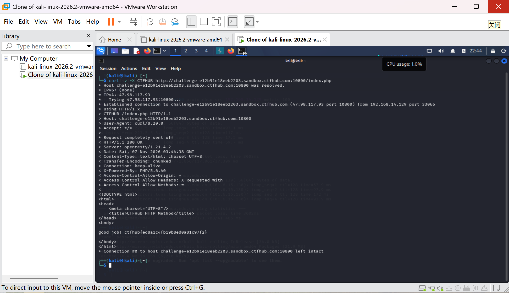

# WP：请求方式

> **CTFHub 路径**：技能树 → Web → Web 前置技能 → HTTP 协议 → 请求方式
> **任务**：按题目要求使用指定的 HTTP 方法访问目标，拿到 flag。
> **提示**：浏览器地址栏默认发送 GET 请求。用 Burp Repeater 修改请求行中的方法，或者用 `curl -X` 复现。
> **截图要求**：优先使用 Burp Repeater，截图中要能看到修改后的请求行（方法 + 路径）和响应中的 flag；如果 Burp 无法启动，可以用 `curl -X` 的方法修改截图代替，并在 WP 中说明原因。只有浏览器普通 GET 访问不算完成。

---

## 题目信息

| 项目 | 内容 |
| --- | --- |
| 环境地址 | http://challenge-e12b91e18eeb2203.sandbox.ctfhub.com:10800/index.php |
| Flag | ctfhub{ed8a1c4fb19b8ed0a81c97f2} |

## 解题过程

打开页面后，题目提示要求客户端直接向服务器申请一个 CTFHUB 方法的请求，而浏览器地址栏只能发 GET/POST，改不了方法。Burp 这次没启起来，我就改用 Kali 终端里的 curl，用 -X CTFHUB 重新请求 index.php。请求行变成了 CTFHUB /index.php HTTP/1.1，服务器返回 200 OK，响应正文里就是 good job! 和 flag。

## 关键请求/响应

```http
CTFHUB /index.php HTTP/1.1
Host: challenge-e12b91e18eeb2203.sandbox.ctfhub.com:10800
User-Agent: curl/8.0.1
Accept: */*

HTTP/1.1 200 OK
Server: openresty/1.21.4.2

good job! ctfhub{ed8a1c4fb19b8ed0a81c97f2}
```

## 原理与复盘

请求行由方法、请求目标（路径）、HTTP 版本三部分组成，例如 CTFHUB /index.php HTTP/1.1，方法是其中最前面、第一个空格之前的那一段。HTTP 允许自定义方法，服务端如果没有做方法白名单，就会把这个非标准方法当成普通请求处理，于是只要改一个词就能绕开"只能 GET 访问"的限制。

---

## 截图



> 可以在这份 WP 中另加过程截图；检查时只看指定图片，额外图片不检查。
