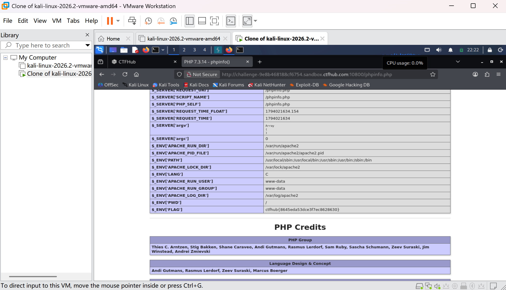

# WP：PHPINFO

> **CTFHub 路径**：技能树 → Web → 信息泄露 → PHPINFO
> **任务**：在 phpinfo 页面中找到 flag，并观察它泄露了哪些信息。
> **提示**：phpinfo 会输出大量 PHP 和服务器配置。用浏览器的查找功能搜索关键字，同时留意页面暴露的路径、版本、环境变量等信息。
> **截图要求**：能看到 phpinfo 页面、你搜索/定位到的 flag，以及至少一处敏感信息。

---

## 题目信息

| 项目 | 内容 |
| --- | --- |
| 环境地址 | http://challenge-9e8b468188cf6754.sandbox.ctfhub.com:10800/phpinfo.php |
| Flag | ctfhub{8645eda53dce3f7ec8628630} |

## 解题过程

打开 phpinfo.php 后，页面输出的是海量的 PHP 与服务器配置信息，从头往下翻很难找到重点。我直接用浏览器的页面查找功能搜 flag，结果落在 Environment 区域的 $_ENV['FLAG'] 上，值就是 ctfhub{...}。顺便看了一遍页面，还暴露了操作系统类型、PHP 8.x 版本、Apache 的绝对路径 /var/www/html 等信息。

## 关键请求/响应

```http
GET /phpinfo.php HTTP/1.1
Host: challenge-9e8b468188cf6754.sandbox.ctfhub.com:10800

HTTP/1.1 200 OK
Content-Type: text/html; charset=UTF-8

$_ENV['FLAG'] => ctfhub{8645eda53dce3f7ec8628630}
```

## 原理与复盘

phpinfo 会把 PHP 版本、编译参数、模块、环境变量、脚本绝对路径、服务器软件版本等信息全部打印出来。这些内容本身不算漏洞，但等于给攻击者一份精准的"环境清单"：知道版本就能找对应的 CVE，知道绝对路径就能配合文件包含、目录遍历，看到数据库账号密码更是直接接管。所以生产环境一旦留下 phpinfo 页面，通常被列为高危信息泄露。

---

## 截图



> 可以在这份 WP 中另加过程截图；检查时只看指定图片，额外图片不检查。
