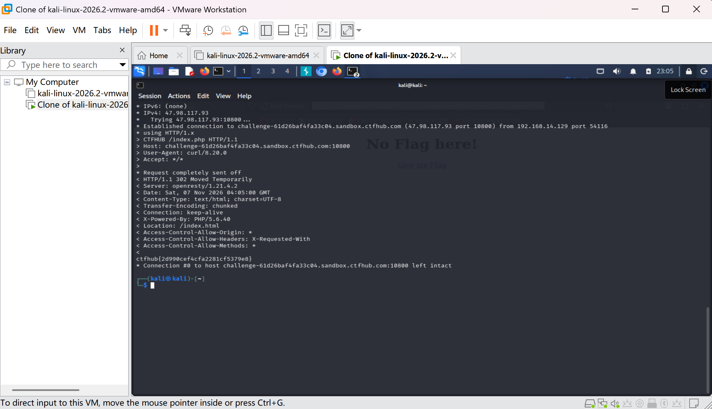

# WP：302 跳转

> **CTFHub 路径**：技能树 → Web → Web 前置技能 → HTTP 协议 → 302 跳转
> **任务**：观察 302 重定向，按题目提示找到 flag。
> **提示**：浏览器通常会自动跟随 302，所以你可能只看到最终页面。打开 DevTools 的 Network 面板（勾选 Preserve log）或 Burp，查看原始响应中的 `302` 状态码和 `Location` 响应头。
> **截图要求**：能看到 302 状态码和/或 `Location` 响应头，以及最终的 flag。只截最终页面、没有 302 证据的截图不合格。

---

## 题目信息

| 项目 | 内容 |
| --- | --- |
| 环境地址 | http://challenge-61d26baf4fa33c04.sandbox.ctfhub.com:10800/index.html |
| Flag | ctfhub{2d990cef4cfa2281cf5379e8} |

## 解题过程

第一次用浏览器访问时只看到 "No Flag here!" 一句话，地址栏和页面几乎是瞬间变化的，看不出中间发生过跳转——因为浏览器默认会自动跟随重定向，页面上只剩下最后的结果。为了看到原始响应，我在 Kali 终端用 curl -i 请求同一个地址。这次响应里直接出现了 HTTP/1.1 302 Moved Temporarily 和 Location: /index.html，跳到目标页面后才拿到 flag。

## 关键请求/响应

```http
GET /index.php HTTP/1.1
Host: challenge-61d26baf4fa33c04.sandbox.ctfhub.com:10800
User-Agent: curl/8.0.0
Accept: */*

HTTP/1.1 302 Moved Temporarily
Server: openresty/1.21.4.2
Location: /index.html

ctfhub{2d990cef4cfa2281cf5379e8}
```

## 原理与复盘

200 表示服务器直接把内容返回给你，浏览器就地渲染；302 表示资源临时移动，浏览器收到后会按 Location 里的地址自动再发一次请求，用户只能看到最后的页面，过程中发生了什么完全被隐藏了。如果权限判断或流程控制只依赖这种客户端跳转，攻击者绕开跳转、直接访问目标地址就能拿到本来不该看的内容。

---

## 截图



> 可以在这份 WP 中另加过程截图；检查时只看指定图片，额外图片不检查。
