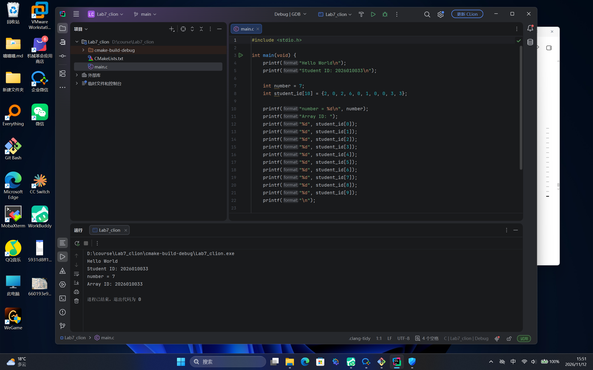
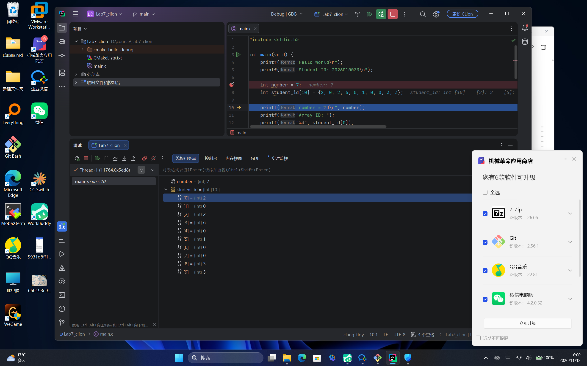

# Lab7：使用 CLion 完成 C 程序输出与断点调试

> **实验目标**：在 Windows 本机使用 CLion 建立并运行 C 程序，完成文字输出、整数变量输出、学号数组定义和固定下标访问，最后使用断点和单步执行观察变量值。

## 一、实验任务与提交内容

| 顺序 | 任务 | 完成标志 |
| :---: | :--- | :--- |
| 1 | 使用 CLion 输出 Hello World | Run 窗口显示 `Hello World` |
| 2 | 输出本人学号 | 使用一条 `printf` 输出完整的 10 位学号 |
| 3 | 定义并输出一个 `int` 变量 | 输出变量保存的整数 |
| 4 | 定义由学号数字构成的数组 | 10 个数组元素分别对应学号的 10 位数字 |
| 5 | 手写固定下标，依次输出数组元素 | 用十条输出语句按顺序输出学号，不使用循环 |
| 6 | 使用 CLion 断点调试 | 程序在断点处暂停，能查看变量和数组，并完成单步执行 |

最终提交 `Lab7.md`、`lab7_basics.c` 和两张截图，共 4 个文件。

## 二、实验环境

| 项目 | 内容 |
| :--- | :--- |
| 操作系统 | Windows 11 家庭中文版（Build 26200） |
| IDE | CLion 2026.3（Build 263.7307.209） |
| 工具链 | Bundled MinGW |
| 构建配置 | Debug |
| 语言标准 | C11 |

项目名 `Lab7_clion`，位于课程仓库之外，仅编辑 `main.c`，保留自动生成的 `CMakeLists.txt`。

## 三、程序代码

完整源码见 [lab7_basics.c](lab7_basics.c)，主要内容如下（学号为 2026010033）：

```c
#include <stdio.h>

int main(void) {
    printf("Hello World\n");
    printf("Student ID: 2026010033\n");

    int number = 7;
    int student_id[10] = {2, 0, 2, 6, 0, 1, 0, 0, 3, 3};

    printf("number = %d\n", number);
    printf("Array ID: ");
    printf("%d", student_id[0]);
    printf("%d", student_id[1]);
    printf("%d", student_id[2]);
    printf("%d", student_id[3]);
    printf("%d", student_id[4]);
    printf("%d", student_id[5]);
    printf("%d", student_id[6]);
    printf("%d", student_id[7]);
    printf("%d", student_id[8]);
    printf("%d", student_id[9]);
    printf("\n");

    return 0;
}
```

## 四、实验报告

### 4.1 基本信息

| 项目 | 本人记录 |
| :--- | :--- |
| 姓名 | 刘正康 |
| 10 位学号 | 2026010033 |
| Windows 版本 | Windows 11 家庭中文版 Build 26200 |
| CLion 版本 | CLion 2026.3（Build 263.7307.209） |

### 4.2 程序运行记录

本人最终程序的完整四行输出：

```text
Hello World
Student ID: 2026010033
number = 7
Array ID: 2026010033
```

本人使用的变量与数组数据：

| 项目 | 本人记录 |
| :--- | :--- |
| `int` 变量名称及初始值 | `number`，初始值 `7` |
| 学号数组名称及十个初始值，按顺序用逗号分隔 | `student_id`，`2, 0, 2, 6, 0, 1, 0, 0, 3, 3` |
| 直接输出的学号与数组输出的学号是否一致 | 一致，均为 `2026010033` |

### 4.3 调试观察记录

| 观察项目 | 本人记录 |
| :--- | :--- |
| 设置断点的源码语句 | `int number = 7;` |
| 整数变量初始化完成后的高亮语句及变量值 | 高亮停在 `int student_id[10] = {2, 0, 2, 6, 0, 1, 0, 0, 3, 3};`，Variables 中 `number = 7` |
| 数组初始化完成后，下标 `0` 和下标 `9` 的值 | `student_id[0] = 2`，`student_id[9] = 3` |
| 对一条 `printf` 执行 Step Over 前后的高亮语句 | 前：`printf("number = %d\n", number);`；后：`printf("Array ID: ");` |

### 4.4 简要说明

1. `printf("7\n");` 与 `printf("%d\n", number);` 分别从哪里取得输出内容？

   > 前者直接输出双引号内的字符串字面量 `7`；后者读取变量 `number` 在内存中的当前值，按 `%d` 指定的十进制整数格式输出，所以变量值改变后输出随之改变。

2. 学号数组有十个元素，为什么输出时使用下标 `0` 至 `9`？下标 `3` 对应学号第几位？

   > C 语言数组下标从 `0` 开始，十个元素的下标范围正好是 `0` 至 `9`。下标 `3` 对应第 4 个元素，即学号第 4 位数字 `6`。

3. 首次暂停在 `int number = 7;` 时，为什么需要执行 Step Over 后再记录变量的初始值？

   > 断点暂停在该行语句执行之前，此时初始化尚未完成，Variables 中显示的可能是未赋值的数据；执行一次 Step Over 让这条初始化语句执行完成后，才能读取到本次初始化的结果 `7`。

### 4.5 实验截图

| 文件 | 必须能够辨认的内容 |
| :--- | :--- |
| `imgs/lab7_run.png` | CLion 中的 C 源码及完整四行运行输出；直接输出与数组输出均为本人学号 |
| `imgs/lab7_debug.png` | CLion 中命中断点或单步后的暂停位置、Variables 中整数变量的值及展开的十个数组元素 |





## 五、实验小结

本次实验在 CLion 中完成了从新建 C 项目、编写输出语句、定义变量与数组，到断点调试观察执行过程的完整流程。通过任务二与任务三的对比，理解了字符串字面量与变量取值的区别；通过任务五手写十条固定下标输出，明确了下标从 `0` 开始、下标 `3` 对应学号第 4 位；通过任务六的断点与 Step Over，直观看到 `int number = 7;` 在暂停时尚未执行、执行后才生效，以及 `student_id` 十个元素与学号各位的对应关系。
