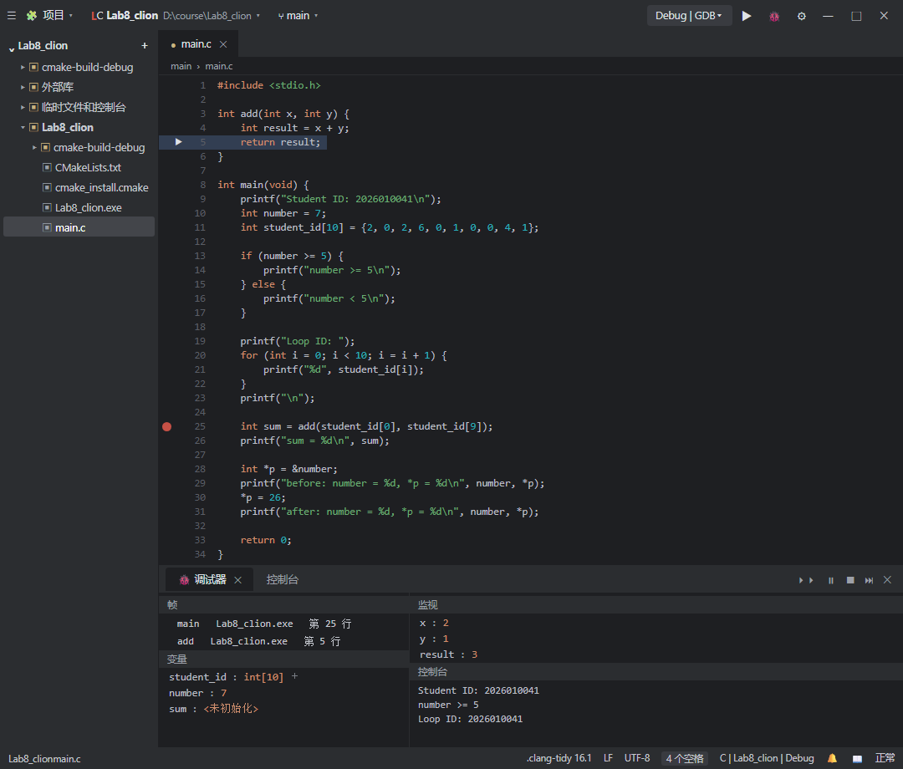
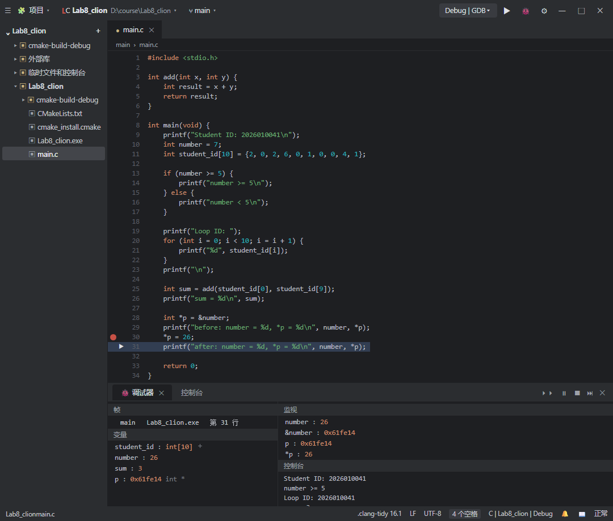
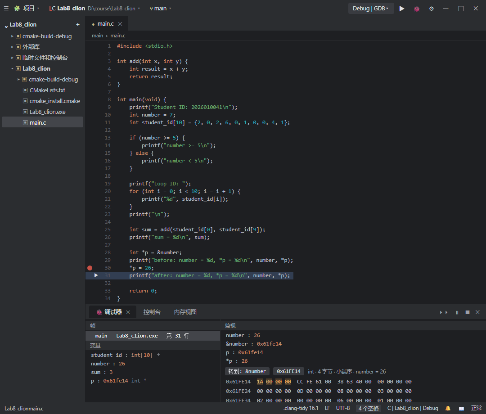
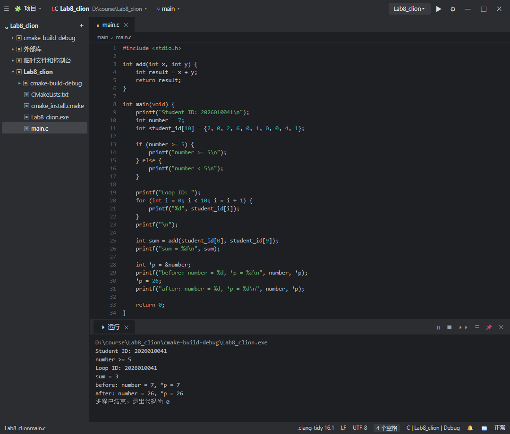

# Lab8：逐步编写并调试判断、循环、函数与整数指针

> **实验目标**：在 Lab7 的整数变量与学号数组基础上，依次增加条件判断、循环、函数和整数指针，通过运行与单步调试解释每一步的执行结果。再用一个给定短程序认识字符数组、字符串参数与比较结果；使用内存视图，将一个整数的地址、十六进制字节与十进制值对应起来；最后在 Kali 中用 `gcc` 编译运行已完成的整数练习程序。
>
> **实验环境**：前五步继续使用 Windows 本机的 CLion、C11 和 Debug 构建配置；第六步使用 Lab3 的 Kali x86-64，用命令行 `gcc` 编译整数练习的同一份 C 文件。主体任务使用一个 `main.c` 逐步完成，每完成一步先运行并核对，再继续增加代码；6.4 的字符串短练习使用单独的 CLion 项目。
>
> **学习要求**：能够说明条件决定执行哪一段、循环每轮读取哪个元素、函数如何接收参数并返回结果，通过整数指针修改了哪个变量，以及用 `gcc` 在 Kali 中编译并运行同一份 C 文件。整数指针只涉及指向普通 `int` 变量的 `int *`；字符串练习只要求认识字符数组的结束符、首字符地址和比较函数的返回含义。

## 一、任务安排与提交内容

| 顺序 | 本次增加的内容 | 需要完成的观察 |
| :---: | :--- | :--- |
| 1 | `if/else` 判断 | 修改整数，分别观察两个分支 |
| 2 | `for` 循环 | 用循环输出学号，观察下标与数组元素 |
| 3 | 整数加法函数 | 进入函数，核对参数、计算结果和返回值 |
| 4 | `int *` 指针 | 读取所指整数，并通过指针修改原变量 |
| 4 后短练习 | 字符数组与字符串比较（6.4） | 运行给定程序，观察 `same` / `different`，调试参数和返回值 |
| 5 | Memory View 演示与课后作业 | 课堂看地址定位；课后截图并记录字节及其表示的整数 |
| 6 | 在 Kali 中编译运行 | 用 `gcc` 生成可执行文件，核对同一程序的六行输出 |

课堂可按“准备 5 分钟、判断 10 分钟、循环 15 分钟、函数 15 分钟、整数指针 15 分钟、字符串短练习 15 分钟、Memory View 演示 5 分钟、Kali 编译运行 10 分钟”安排，共 90 分钟。主体程序逐步增加代码；字符串练习使用教师提供的完整源码，不要求从零编写，也不增加截图和提交文件。Memory View 课堂只演示地址定位并快速复习小端，学生课后独立截图、填写记录。Kali 只做编译和运行，不调试，也不增加截图；命令与输出直接粘贴到 8.3 节。课前启动 Kali，并确认 `gcc` 可用，避免把课堂时间用于安装工具。

材料目录：

```text
homework/Lab8/
├── Lab8.md
└── lab8_basics.c    最终程序示例，供逐步完成后核对
```

字符串短练习复用 [Lab9/string_demo.c](../Lab9/string_demo.c)，Lab9 将继续用同一份代码学习 GDB。

最终提交 **报告、本人源码和四张截图，共 6 个文件**。四张截图分别为运行结果、函数调试、指针调试和内存视图；Kali 编译运行只记录命令与输出，不增加截图。具体清单见第十节。

四张截图的引用分别放在对应操作处。保留说明和示例，只填写标有“本人”的简答与记录；截图中已经清楚显示的数值无需再逐项抄表。

## 二、准备起始程序

新建一个 C Executable 项目，例如 `Lab8_clion`，语言标准使用 C11，工具链沿用 Lab7 的配置。确认 CMake 设置中的 Build type 为 Debug。项目仍放在课程仓库之外，主体任务只编辑这个项目中的 `main.c`；到 6.4 再创建独立的字符串练习项目。

将 `main.c` 替换为以下起始程序：

```c
#include <stdio.h>

int main(void) {
    printf("Student ID: 2026010099\n");
    int number = 7;
    int student_id[10] = {2, 0, 2, 6, 0, 1, 0, 0, 9, 9};

    return 0;
}
```

将文字输出和数组定义中的示例学号分别替换为本人学号。先点击 Run，确认本人学号能够正常输出。`number` 与数组暂时没有输出，后续任务将逐步使用它们。

后续所说的“增加语句”，均应放在指定位置。除函数定义外，执行语句放在 `main` 的大括号内、`return 0;` 之前。项目中始终只保留一个参与构建且包含 `main` 的源文件。

## 三、第一步：增加条件判断

### 3.1 根据整数值选择输出

在数组定义之后、`return 0;` 之前增加：

```c
if (number >= 5) {
    printf("number >= 5\n");
} else {
    printf("number < 5\n");
}
```

`if` 括号内是条件。`number >= 5` 表示检查 `number` 是否大于或等于 5。条件成立时执行第一对大括号中的语句；条件不成立时执行 `else` 后的语句。每次执行这组判断时，只会选择其中一个分支。

两条 `printf` 中的文字仅用于说明当前分支，不承担判断工作。真正决定执行方向的是 `if` 后括号内的条件。

### 3.2 修改数值并验证两个分支

保持条件不变，依次将变量初始值设置为以下数值。每次先预测输出，再保存并重新 Run：

| `number` 初始值 | 判断过程 | 预期输出 |
| :---: | :--- | :--- |
| 7 | 7 大于或等于 5，条件成立 | `number >= 5` |
| 3 | 3 不大于或等于 5，条件不成立 | `number < 5` |
| 5 | 5 等于 5，条件成立 | `number >= 5` |

观察完成后，将 `number` 恢复为 `7`。后续任务均以该初始值继续。

### 3.3 用断点观察分支选择

1. 在 `if (number >= 5)` 所在行设置断点，点击 Debug。
2. 暂停后确认 Variables 中 `number` 已完成初始化。
3. 执行 Step Over，观察高亮位置进入哪一个分支。
4. 继续单步，观察所选分支执行完后到达判断结构后方；另一分支不会在此次判断中执行。
5. 如需观察另一分支，停止调试，修改初始值并重新 Debug。

观察后在 9.3 节简答中概括分支选择，不要求为每次运行分别截图。不要在 `if (...)` 后添加分号；这里的条件与紧随其后的大括号共同构成判断结构。

## 四、第二步：用循环输出学号

### 4.1 从固定下标改为变化的下标

Lab7 使用十条语句分别访问下标 `0` 至 `9`。本次在判断结构之后增加以下代码，让同一条输出语句重复执行：

```c
printf("Loop ID: ");
for (int i = 0; i < 10; i = i + 1) {
    printf("%d", student_id[i]);
}
printf("\n");
```

`i` 是本循环使用的整数变量，也作为数组下标。第一次读取 `student_id[0]`，下一次读取 `student_id[1]`，依此继续。

`for` 括号中用两个分号分隔三个部分：

| 部分 | 作用 | 执行时机 |
| :--- | :--- | :--- |
| `int i = 0` | 定义下标变量，初始值为 0 | 进入循环时执行一次 |
| `i < 10` | 判断是否还需要执行本轮 | 每轮执行循环体之前检查 |
| `i = i + 1` | 读取当前 `i`，加 1 后保存回 `i` | 每轮循环体执行完成后执行 |

`i = i + 1` 中的 `=` 表示保存计算结果。例如当前 `i` 为 0，执行后变成 1；这不是数学等式，也不是同时存在两个不同的 `i`。

执行顺序为：

```text
i 初始化为 0
    ↓
检查 i < 10 ── 不成立 → 结束循环
    │ 成立
    ↓
输出 student_id[i]
    ↓
i 增加 1
    ↓
再次检查 i < 10
```

### 4.2 核对首轮、后续轮次与结束条件

| 轮次或检查位置 | `i` | 条件结果 | 接下来的操作 |
| :--- | :---: | :--- | :--- |
| 第一轮 | 0 | 成立 | 输出学号第 1 位 |
| 第二轮 | 1 | 成立 | 输出学号第 2 位 |
| 最后一轮 | 9 | 成立 | 输出学号第 10 位 |
| 最后一轮更新之后 | 10 | 不成立 | 结束循环，不访问数组 |

条件必须写成 `i < 10`。若写成 `i <= 10`，还会尝试访问不存在的第 11 个元素，即 `student_id[10]`。

数字输出语句不包含换行，循环结束后才执行 `printf("\n");`，因此十位数字连接在同一行。运行并核对 `Loop ID: ` 后的学号是否与第一行一致。

### 4.3 在同一条语句上观察多轮执行

1. 取消上一节断点，在循环体中的 `printf("%d", student_id[i]);` 设置断点。
2. Debug 后，第一次命中该断点时查看 `i` 和 `student_id[i]`。
3. 点击 Resume，再次命中同一断点时，核对更新后的下标和元素。
4. 继续观察至 `i = 9` 的暂停状态。再次 Resume 后，该断点不再命中，程序继续完成后续语句。

同一源码行可以执行多次。不能仅根据高亮行相同就认为程序没有前进，还应检查下标值。

`i` 定义在 `for` 中，离开循环后可能不再出现在 Variables 中；无需在循环结束后寻找一个显示为 `10` 的变量。根据条件和最后一次更新，可以解释为什么不再进入循环体。

调试 Console 可能延迟显示尚未换行的数字。以暂停位置和变量值判断循环进度，完整输出在运行结束后核对。

## 五、第三步：增加一个整数函数

### 5.1 定义函数

在 `#include <stdio.h>` 之后、`main` 定义之前增加：

```c
int add(int x, int y) {
    int result = x + y;
    return result;
}
```

`add` 将两个整数相加，并将结果交回调用它的位置。

| 代码部分 | 含义 |
| :--- | :--- |
| 开头的 `int` | 函数返回一个整数 |
| `add` | 函数名称 |
| `int x, int y` | 接收两个整数参数，在函数内部使用名称 `x` 和 `y` |
| `int result = x + y;` | 计算两个参数的和，保存到局部变量 `result` |
| `return result;` | 结束本次函数执行，并返回结果 |

函数定义应放在 `main` 外部，不能写进 `main` 的大括号内。虽然 `add` 在源码中位于前面，本程序仍从 `main` 开始；只有执行到调用语句时才进入 `add`。

### 5.2 调用函数并保存返回值

在 `main` 中循环结束后的换行语句之后增加：

```c
int sum = add(student_id[0], student_id[9]);
printf("sum = %d\n", sum);
```

这次调用读取本人学号的第一位和最后一位数字，将它们分别传给 `x`、`y`。函数返回后，把结果保存到 `sum`。

例如，示例学号的首位为 2、末位为 9，则本次调用过程为：

```text
main 读取两个元素：2、9
    → add 中 x = 2、y = 9
    → result = 11
    → 返回整数 11
    → main 中 sum = 11
```

本人学号不同，末位与计算结果可以不同，应按实际值核对。这里传入的是两个元素当前的整数值，不会修改原数组。

### 5.3 进入函数，观察计算与返回

1. 取消循环断点，在 `int sum = add(...);` 这一行设置断点并重新 Debug。
2. 暂停时，`sum` 的初始化尚未完成，先核对传入的两个数组元素值。
3. 执行 **Step Into**（默认 `F7`）进入 `add`。若先停在函数入口，继续单步至函数内第一条计算语句。
4. 在 Variables 中查看参数 `x`、`y`，应与传入的两个元素值相同。
5. 执行 **Step Over**，完成 `result` 的初始化。在 `return result;` 处查看 `x`、`y`、`result`，保存 `imgs/lab8_function.png`。
6. 执行 **Step Out**（默认 `Shift+F8`），返回 `main`。
7. 检查当前高亮位置。若调用语句的初始化仍未完成，继续 Step Over，直到后续输出语句处，再确认 `sum`。

本人函数调试截图：图中应能辨认 `add` 内的参数 `x`、`y` 和已计算完成的 `result`；返回后的 `sum` 与最终运行输出核对即可。



Step Into 用于观察所调用函数内部的执行过程；Step Out 会继续执行当前函数并返回调用者，不会取消函数计算。若直接在调用处使用 Step Over，函数同样会执行，只是通常不会逐行停在其内部。

观察时依据实际暂停位置判断初始化是否完成，不机械地按固定次数读取结果。

## 六、第四步：使用指向整数的指针

### 6.1 先区分整数的值与地址

`number` 保存整数，`&number` 表示该变量所在的地址。它们分别回答“保存什么”和“存在哪里”。

在 `sum` 输出语句之后增加：

```c
int *p = &number;
printf("before: number = %d, *p = %d\n", number, *p);
```

`int *p` 声明一个指向 `int` 的指针变量；`= &number` 使它保存 `number` 的地址。随后使用 `*p`，就可以访问这个地址处的整数，这个操作称为解引用。

| 表达式 | 含义 | 当前预期结果 |
| :--- | :--- | :--- |
| `number` | 原整数变量的值 | `7` |
| `&number` | 原整数变量的地址 | 本次运行中的实际地址 |
| `p` | 指针保存的地址 | 与 `&number` 相同 |
| `*p` | 指针所指整数的值 | 与 `number` 相同，为 `7` |

`int *p` 中的星号用于声明类型，表达式 `*p` 中的星号用于访问所指对象。本次先理解这两种用法，不涉及指针自身的地址或其他指针类型。

### 6.2 通过指针修改原变量

在上一段代码后面继续增加：

```c
*p = 26;
printf("after: number = %d, *p = %d\n", number, *p);
```

`*p = 26;` 的含义是：根据 `p` 保存的地址找到整数，将其值改为 26。由于 `p` 指向 `number`，执行后 `number` 和 `*p` 都应为 26。

这条语句修改的是所指的整数，不是 `p` 保存的地址。此时 `p` 仍指向原来的 `number`。不要将其写成 `p = 26;`，后者试图把普通整数放进指针变量，不能完成本任务。

### 6.3 用调试验证修改前后

1. 取消函数断点，在 `*p = 26;` 所在行设置断点并重新 Debug。
2. 此时指针已初始化，但修改语句还没有执行。确认 Variables 中 `number` 为 7。
3. 在 Debug 窗口的 Watches 中逐项添加 `number`、`&number`、`p`、`*p`，表达式后不加分号。
4. 核对 `p` 与 `&number` 相同，`*p` 与 `number` 均为 7。
5. 执行 Step Over，到达最后一条 `printf`。核对 `number`、`*p` 均变成 26，`p` 与 `&number` 仍相同。
6. 保持暂停，保存 `imgs/lab8_pointer.png`，图中应能辨认上述表达式及其实际值。



地址以本人截图为准，不要求与其他人的地址一致。前后比较必须来自同一次运行，避免把重新启动程序产生的地址变化误判为指针赋值的效果。

最后一次修改发生在程序后半段，因此前面已经执行过的 `if` 不会自动重新判断，已经输出的文字也不会自动变化。

### 6.4 课堂短练习：字符数组、字符串参数与比较结果

Lab9 将用这段代码学习 GDB。本节先在熟悉的 CLion 中读懂、运行并调试它，安排约 15 分钟，不增加截图和提交文件。

**先保存整数练习项目，再新建一个独立的 C Executable 项目，例如 `Lab8_strings`**，仍使用 C11 和 Debug。把 [string_demo.c](../Lab9/string_demo.c) 的完整内容复制到新项目的 `main.c`。不要把它追加到原来的整数程序中，也不要让两个包含 `main` 的文件参与同一个目标的构建。

给定程序如下，不要求从零编写：

```c
#include <stdio.h>
#include <string.h>

int same_text(const char *left, const char *right) {
    int result = strcmp(left, right);
    return result == 0;
}

int main(void) {
    char input[] = "Hi";
    char expected[] = "Hi";
    int same = same_text(input, expected);
    if (same) {
        printf("same\n");
    } else {
        printf("different\n");
    }
    return 0;
}
```

**先读代码，再运行两种情况。** `char` 数组每个元素占 1 字节；本实验中 `"Hi"` 保存为 `48 69 00`，末尾的 `00` 是结束符 `\0`。因此 `input` 和 `expected` 各占 3 字节。与整数数组相比，这里每个元素保存一个字符，而不是一个 `int`。

调用 `same_text(input, expected)` 时，传入的是两个数组首字符的地址。`const char *left`、`const char *right` 接收这些地址；`const` 表示函数不通过这两个指针修改字符。与 `add` 接收整数值不同，这个函数根据传入的地址读取字符串内容。

`#include <string.h>` 声明了这里使用的 `strcmp`。它比较两串内容，相同返回 0，不同返回非零；`same_text` 再用 `result == 0` 得到“相同为 1，不同为 0”的结果。`==` 是比较，`=` 是赋值；`if (same)` 在 `same` 非零时执行第一分支。

| `input` | `expected` | `strcmp` 的结果 | `same_text` 的返回值 | 程序输出 |
| :--- | :--- | :--- | :--- | :--- |
| `"Hi"` | `"Hi"` | 0 | 1 | `same` |
| `"Ho"` | `"Hi"` | 非零，不要求固定数值 | 0 | `different` |

1. 保持两个数组都是 `"Hi"`，点击 Run，核对输出 `same`。
2. 只把 `input` 改成 `"Ho"`，保存并重新 Run，核对输出 `different`。
3. 将 `input` 恢复为 `"Hi"`，保存，再开始下面的调试。

**用刚学过的函数调试方法观察一次。** 在 `int same = same_text(input, expected);` 设置断点并 Debug。暂停后确认两个数组均已初始化，再 Step Into 进入 `same_text`，查看 `left`、`right` 指向的文字。停在 `strcmp` 调用所在行时使用 Step Over，执行完后在 `return result == 0;` 处查看 `result = 0`，不进入库函数内部。先预测本函数会返回什么，再 Step Out 返回 `main`；必要时继续 Step Over，直到 `same` 初始化完成，核对 `same = 1`。

口头说明两个问题：为什么 `result = 0` 时 `same` 却是 1？传给 `same_text` 的是整串文字，还是文字所在的地址？**不同函数的返回含义取决于函数约定，不能把所有比较函数的 0 都理解成失败。**

练习结束后切回 `Lab8_clion` 整数项目。后续 Memory View、Kali 编译和最终提交仍使用整数练习程序；字符串程序保留供复习，不加入六行输出，也不提交。

## 七、第五步：内存视图截图与数值解释

本节为必做的课后作业，课堂先由教师演示约 5 分钟。切回 `Lab8_clion` 整数项目，使用 6.3 中通过指针修改后的 `number`，完成“变量值—原始字节”的核对。课后截图与填写记录不占用最后的 Kali 编译时间。

Lab7 已经用课堂示例看过整数和数组在内存中的排布、进制转换和小端顺序；本节不重复讲这些原理，只新增在 CLion Memory View 中怎样取得 `&number` 的地址，以及怎样从该地址读连续四字节。7.2 只做一次快速核对。

### 7.1 定位变量地址并截图

1. 在整数项目中重新 Debug，在 `*p = 26;` 执行完成后的最后一条 `printf` 行暂停，确认 Variables 中 `number = 26`。
2. 在 Variables 中选中 `number`，按 `Ctrl+Enter`，或右键选择 **Show in Memory View**。
3. 在 Memory View 的 **Go to** 中输入 `&number`，定位到该整数的起始地址。
4. 从该地址开始读取连续四个字节，同时对照 Watches 中的 `&number`。
5. 保存 `imgs/lab8_memory.png`，图中应能辨认变量起始地址、四个字节和 Variables 或 Watches 中的 `number` 值。



Memory View 的操作入口与地址定位方式可参考 [CLion 官方说明](https://www.jetbrains.com/help/clion/memory-view.html)。窗口每行显示的字节数可能不同，应从 `&number` 指定的位置开始数四个字节，不能把整行数据都作为该变量。

### 7.2 区分地址与数据的十六进制表示

本实验 Windows MinGW 环境中的 `int` 占 4 字节，采用小端字节序。对于整数 26，从低地址到高地址读取其四个字节应得到：

```text
变量起始地址：以本人 &number 的实际值为准
字节偏移：    +0  +1  +2  +3
原始字节：    1a  00  00  00
```

地址列中的十六进制数表示“位置”；字节区的十六进制数表示“该位置保存的数据”。本次转换为十进制的是变量数据，不是地址。

小端序将整数的最低有效字节放在最低地址处。因此，上述字节对应整数的十六进制表示为 `0x0000001a`，不是把显示顺序直接拼接为 `0x1a000000`。

十六进制中的 `a` 表示十进制 10，所以：

```text
0x0000001a = 1 × 16 + 10 = 26
```

无需将地址本身转成十进制，也不要求分析相邻的其他内存。根据上方本人截图，用一句话把实际地址、从低地址到高地址的四个字节、对应的十六进制整数和十进制值连起来，并说明是否与调试窗口一致。

> 本人内存解释：本次运行中 `number` 的起始地址为 `0x61FE14`，从低地址到高地址的四个字节依次为 `1a`、`00`、`00`、`00`，按小端序组成 `0x0000001a`，即十进制 26，与调试窗口中 `number` 的值一致。

## 八、第六步：在 Kali 中编译并运行同一份 C 文件

Lab9 将完全在 Kali 命令行中编译、运行和调试程序。本步先用已经完成的 Lab8 程序走一遍“源码 → 编译 → 可执行文件 → 运行”，确认同一份 C 源码在 Kali 中也能得到相同结果。本次不在 Kali 中调试，不增加截图；把命令和输出直接粘贴到 8.3 节。

### 8.1 把最终源码复制到 Kali

复制前切回 `Lab8_clion` 整数项目，确认前四步的程序能输出六行；完整结构见 9.1，提交前还会再核对一次。第五步的课后内存截图不影响本步编译。确认 `number` 已恢复为 7、指针写入仍为 26，不要误复制字符串项目的 `main.c`。

在课程仓库根目录下建立个人作业目录 `学号姓名/Lab8/`，把 CLion 项目中已经运行通过的最终 `main.c` 复制进去，副本命名为 `lab8_basics.c`。这个文件也是第十节要提交的源码。

在 Kali 终端建立实验目录：

```bash
mkdir -p ~/Lab8
cd ~/Lab8
pwd
```

使用 Remote-SSH 时，把 `lab8_basics.c` 拖入远程 `~/Lab8/`。也可以在 Windows Git Bash 的课程仓库根目录执行，替换用户名、IP 和学号姓名：

```bash
scp 学号姓名/Lab8/lab8_basics.c kali@虚拟机IP:~/Lab8/
```

回到 Kali 执行：

```bash
cd ~/Lab8
ls -l
cat lab8_basics.c
```

`ls -l` 应看到 `lab8_basics.c`；`cat` 应显示与 CLion 中相同的最终源码。`cat` 只显示内容，不修改文件。

### 8.2 编译并运行

在 Kali 中逐条执行：

```bash
uname -m
gcc -std=c11 -Wall -Wextra -o lab8_basics lab8_basics.c
file lab8_basics
./lab8_basics
```

`uname -m` 应输出 `x86_64`，与 Lab9 使用的 Bomb 版本一致。`gcc` 把文本源码编译成可执行文件：`-std=c11` 指定 C11 标准，`-Wall -Wextra` 打开常用警告，`-o lab8_basics` 指定输出文件名。**编译成功时通常没有输出**；若出现错误，先处理第一条错误，修正源码后重新编译。若提示 `gcc: command not found`，先执行 `sudo apt update && sudo apt install -y gcc`；本节只需要编译器，GDB 等工具在 Lab9 再安装。

`file lab8_basics` 应显示 ELF 64-bit、x86-64。`./lab8_basics` 运行当前目录中的可执行文件；只写 `lab8_basics` 可能提示找不到命令，因为当前目录通常不在 `PATH` 中。

示例学号对应的六行输出为：

```text
Student ID: 2026010099
number >= 5
Loop ID: 2026010099
sum = 11
before: number = 7, *p = 7
after: number = 26, *p = 26
```

本人学号和首末两位之和以实际情况为准，行数和内容结构应与 CLion 中的最终运行结果一致。

`.c` 文件是文本源码，`lab8_basics` 是编译后生成的机器码文件。修改源码后必须重新执行 `gcc`；只保存源码不会改变已有的可执行文件。CLion 的 Run 按钮在内部也完成编译和运行，只是把命令隐藏起来。

### 8.3 记录与核对

运行结束后，直接粘贴本人 `uname -m`、`gcc`、`file` 和 `./lab8_basics` 的命令及输出，保留六行程序输出。编译成功没有输出时，保留命令即可，不截图，也不再填写同样内容的表格。

```text
kali@kali:~$ mkdir -p ~/Lab8
kali@kali:~$ cd ~/Lab8
kali@kali:~/Lab8$ pwd
/home/kali/Lab8
kali@kali:~/Lab8$ ls -l
总计 4
-rw-r--r-- 1 kali kali 1237 11月13日 20:41 lab8_basics.c
kali@kali:~/Lab8$ cat lab8_basics.c
（显示与 CLion 中相同的最终源码：add 函数、Student ID: 2026010041、number、
student_id 数组 {2, 0, 2, 6, 0, 1, 0, 0, 4, 1}、if/else、for 循环、add 调用与指针部分）
kali@kali:~/Lab8$ uname -m
x86_64
kali@kali:~/Lab8$ gcc -std=c11 -Wall -Wextra -o lab8_basics lab8_basics.c
kali@kali:~/Lab8$ file lab8_basics
lab8_basics: ELF 64-bit LSB pie executable, x86-64, version 1 (SYSV), dynamically linked, interpreter /lib64/ld-linux-x86-64.so.2, for GNU/Linux 3.2.0, not stripped
kali@kali:~/Lab8$ ./lab8_basics
Student ID: 2026010041
number >= 5
Loop ID: 2026010041
sum = 3
before: number = 7, *p = 7
after: number = 26, *p = 26
```

> 本人核对：编译无警告或错误，输出一致。`uname -m` 为 `x86_64`，`file` 显示 ELF 64-bit、x86-64；六行输出与 CLion 中的最终运行结果一致（学号 2026010041、sum = 3、指针修改前后 7/26）。

若输出与 CLion 不同，先确认 `~/Lab8/lab8_basics.c` 是最新版本，再重新编译；不要在旧可执行文件上反复运行。

## 九、最终程序与实验报告

### 9.1 最终程序核对

完成前四步后，整数程序应包含如下结构。可用 [lab8_basics.c](lab8_basics.c) 核对，学号文字和数组中的数字须替换为本人信息。临时分支实验完成后，将 `number` 初始值恢复为 7，指针写入值保留为 26。

```c
#include <stdio.h>

int add(int x, int y) {
    int result = x + y;
    return result;
}

int main(void) {
    /* 将两处示例学号替换为本人学号。 */
    printf("Student ID: 2026010099\n");
    int number = 7;
    int student_id[10] = {2, 0, 2, 6, 0, 1, 0, 0, 9, 9};

    if (number >= 5) {
        printf("number >= 5\n");
    } else {
        printf("number < 5\n");
    }

    printf("Loop ID: ");
    for (int i = 0; i < 10; i = i + 1) {
        printf("%d", student_id[i]);
    }
    printf("\n");

    int sum = add(student_id[0], student_id[9]);
    printf("sum = %d\n", sum);

    int *p = &number;
    printf("before: number = %d, *p = %d\n", number, *p);
    *p = 26;
    printf("after: number = %d, *p = %d\n", number, *p);

    return 0;
}
```

示例学号对应六行输出：

```text
Student ID: 2026010099
number >= 5
Loop ID: 2026010099
sum = 11
before: number = 7, *p = 7
after: number = 26, *p = 26
```

本人学号和首末两位之和以实际情况为准。运行最终程序并保存 `imgs/lab8_run.png`，截图应显示 CLion 中的源码及六行输出。



### 9.2 本人基本信息

> 姓名：张萌；10 位学号：2026010041

### 9.3 简短总结

每题用一两句话回答即可。函数参数、指针地址和最终输出已在对应截图中展示，无需再次抄写。

1. `number` 为 7、3、5 时分别选择哪个分支？循环为什么使用 `i < 10`，而不是 `i <= 10`？

   > 本人回答：7 和 5 都大于或等于 5，条件成立，进入 `if` 分支输出 `number >= 5`；3 不满足条件，进入 `else` 分支输出 `number < 5`。数组只有下标 0 至 9 共 10 个元素，`i < 10` 使循环恰好执行 10 轮；若写成 `i <= 10`，最后一轮会以 `i = 10` 访问不存在的 `student_id[10]`，读越界内存。

2. 结合本人的函数截图和运行结果，说明 `add` 怎样接收学号首末两位并把结果交回 `sum`。

   > 本人回答：调用 `add(student_id[0], student_id[9])` 时，数组首末两个元素 `2` 和 `1` 作为实参分别传入形参 `x`、`y`（见函数调试截图中 `x = 2`、`y = 1`）；函数内 `result = x + y` 算出 3，经 `return result;` 交回调用处，`main` 中 `sum` 接收到 3，输出 `sum = 3`。

3. 执行 `*p = 26;` 后，为什么 `number` 也变成 26，而 `p` 保存的地址没有变化？

   > 本人回答：`p` 中保存的是 `number` 的地址，`*p = 26;` 按这个地址找到该整数并写入 26，实际修改的就是 `number` 本身，所以 `number` 与 `*p` 同时变为 26；这条语句只改了所指整数，没有给 `p` 赋新地址，因此 `p` 仍等于 `&number`（见指针调试截图中前后均为 `0x61fe14`）。

若操作中遇到问题，在这里简述问题与解决方法；没有则写“无”。Kali 中的问题已在 8.3 节记录的，不重复填写。

> 本人操作问题：无。

## 十、文件提交与截止时间

第八节已经把最终 `main.c` 复制为个人作业目录中的 `lab8_basics.c`；提交前确认它仍是最终版本。项目内继续使用 `main.c`，无需修改构建配置。使用电脑截图功能生成 PNG，不使用手机拍屏。

```text
学号姓名/
└── Lab8/
    ├── Lab8.md
    ├── lab8_basics.c
    └── imgs/
        ├── lab8_run.png
        ├── lab8_function.png
        ├── lab8_pointer.png
        └── lab8_memory.png
```

提交前核对：

- 报告各填写位置均已完成，源码、个人学号、输出和截图相互对应。
- 7.2 节已有本人内存解释；8.3 节已有实际 Kali 命令、六行输出及核对结果；9.3 节已完成三道简答。
- 四张 PNG 均能在 Markdown 预览中显示，单张不超过 5 MB，关键值可辨认。
- 只提交上述六个文件，不提交 CLion 项目、`.idea`、构建目录、可执行文件或压缩包。

PR 标题为 `[学号姓名]Lab8作业提交`，右方括号后不留空格；一个 PR 只包含本人的本次 Lab8 文件。

**截止时间：2026 年 11 月 20 日 24:00（即 2026 年 11 月 21 日 00:00，北京时间）。**

以 GitHub 记录的最后一次向 PR 推送的时间为准。截止之后新建 PR 或继续推送修改均按超时处理。

## 十一、常见问题

| 现象 | 检查与处理 |
| :--- | :--- |
| `else` 附近构建报错 | 检查 `if` 后是否误加分号、大括号是否配对，`else` 是否紧随对应的 `if` 代码块 |
| 循环没有结束 | 检查是否保留 `i = i + 1`，以及条件是否为 `i < 10` |
| 学号多输出一位或出现异常数值 | 检查是否误写 `i <= 10`，下标只能使用 0 至 9 |
| 函数定义报错 | 将 `add` 定义放在 `main` 外部、`main` 前面，并检查大括号 |
| 看不到函数内的变量 | 确认通过 Step Into 进入了 `add`，且相关初始化已完成 |
| Step Out 后 `sum` 尚未显示预期值 | 检查是否仍停在调用行，继续单步至初始化完成后读取 |
| 指针相关构建警告或错误 | 检查声明是否为 `int *p = &number;`，修改整数是否为 `*p = 26;` |
| 指针求值失败 | 确认暂停在 `main` 中，且指针初始化已经执行完成 |
| 内存视图中的字节不对应 26 | 确认 `*p = 26;` 已执行，Go to 使用本次运行的 `&number`，只读取起始位置后的四个字节 |
| 地址与上一次运行不同 | 正常记录本轮地址；指针前后变化应在同一次运行中比较 |
| 修改源码后结果不变 | 保存后重新 Run 或 Debug，确认构建成功，不使用历史输出作为结果 |
| Kali 中提示 `gcc: command not found` | 先执行 `sudo apt update`，再执行 `sudo apt install -y gcc`；安装后重新执行 `gcc` 命令 |
| Kali 中 `uname -m` 不是 `x86_64` | 后续 Bomb 与 Attack Lab 的二进制按 x86-64 准备；联系教师改用 x86-64 Kali，不要继续在 ARM 环境套用地址 |
| Kali 中提示找不到 `lab8_basics.c` | 执行 `pwd` 和 `ls -l`，确认当前在 `~/Lab8`，且文件名拼写一致；必要时重新复制文件 |
| Kali 中提示 `Permission denied` | 使用 `./lab8_basics` 运行，并确认前面的 `gcc` 命令已经成功生成该文件 |
| Kali 输出与 CLion 不同 | 确认复制到 `~/Lab8/` 的 `lab8_basics.c` 是最终版本，重新执行 `gcc` 后再运行 |
