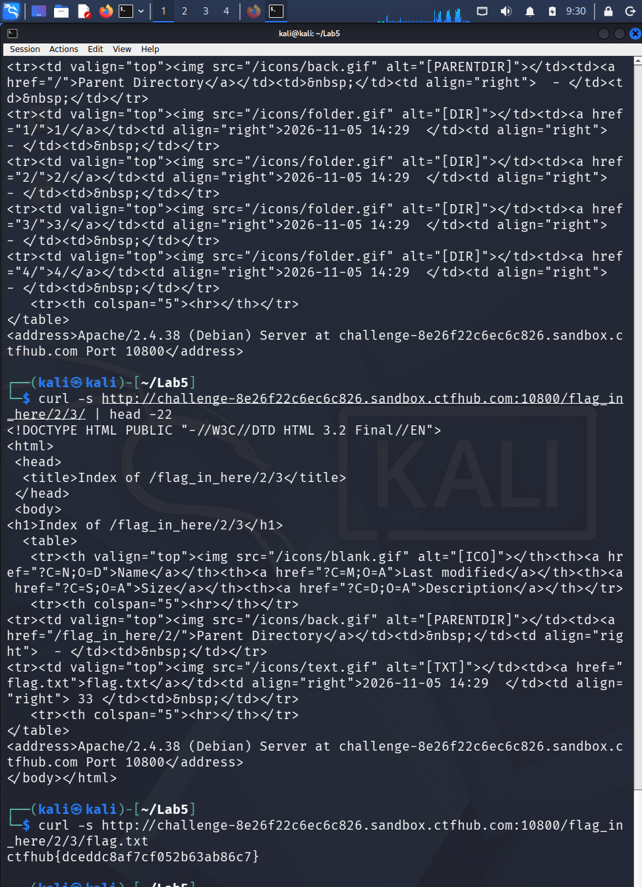

# WP：目录遍历

> **CTFHub 路径**：技能树 → Web → 信息泄露 → 目录遍历
> **任务**：按题目页面提示找到 flag。
> **提示**：注意页面给出的路径和 URL；目录列表本身就是一种信息泄露。只在题目环境内点击和访问，不要使用扫描器扫描其他地址。
> **截图要求**：能看到题目环境地址（或题目名称）、你访问的目录/路径，以及最终的 flag。

---

## 题目信息

| 项目 | 内容 |
| --- | --- |
| 环境地址 | http://challenge-8e26f22c6ec6c826.sandbox.ctfhub.com:10800 |
| Flag | ctfhub{dceddc8af7cf052b63ab86c7} |

## 解题过程

打开首页是一个 Bootstrap 页面，中间只有「目录遍历」标题和「点击开始寻找 flag」按钮，链接指向 `flag_in_here/`。点进去之后服务器并没有返回 403，而是直接给出一个 Apache 风格的目录索引页，标题是 `Index of /flag_in_here`，下面列出 `1/`、`2/`、`3/`、`4/` 四个子目录。我在 Kali 的 Firefox 里沿着目录一层层点下去，同时在终端用 `curl` 复现同样的路径，最后在 `/flag_in_here/2/3/` 下看到一个 33 字节的 `flag.txt`，访问它就拿到了 flag。整个过程中没有用任何扫描器，全是顺着页面自己给出的目录列表走的。

## 关键请求/响应

```http
GET /flag_in_here/ HTTP/1.1
Host: challenge-8e26f22c6ec6c826.sandbox.ctfhub.com:10800
User-Agent: curl/8.5.0

HTTP/1.1 200 OK
Server: openresty/1.21.4.2
Content-Type: text/html; charset=utf-8

<h1>Index of /flag_in_here</h1>
<tr><td valign="top"></td><td><a href="1/">1/</a></td> ...
<tr><td valign="top"></td><td><a href="2/">2/</a></td> ...
<tr><td valign="top"></td><td><a href="3/">3/</a></td> ...
<tr><td valign="top"></td><td><a href="4/">4/</a></td> ...
<address>Apache/2.4.38 (Debian) Server at challenge-8e26f22c6ec6c826.sandbox.ctfhub.com Port 10800</address>

GET /flag_in_here/2/3/flag.txt HTTP/1.1
Host: challenge-8e26f22c6ec6c826.sandbox.ctfhub.com:10800

HTTP/1.1 200 OK
Content-Type: text/plain; charset=utf-8
Content-Length: 33
Last-Modified: Thu, 05 Nov 2026 14:29:41 GMT

ctfhub{dceddc8af7cf052b63ab86c7}
```

## 原理与复盘

这道题对应 HTTP 报文里**请求行中的 URL 路径**：不用改任何请求头，只要把路径换成目录，服务器就把该目录下的文件名列表写进**响应体**返回。目录列表本身就是信息泄露——服务器本该用 `Options -Indexes` 关掉自动索引，一旦打开，备份文件、源码、配置甚至 flag 都会被人顺着文件名枚举出来。所以这题的教训不只是"会点目录"，而是"服务器不该把目录结构告诉访问者"。

---

## 截图



> 可以在这份 WP 中另加过程截图；检查时只看指定图片，额外图片不检查。
