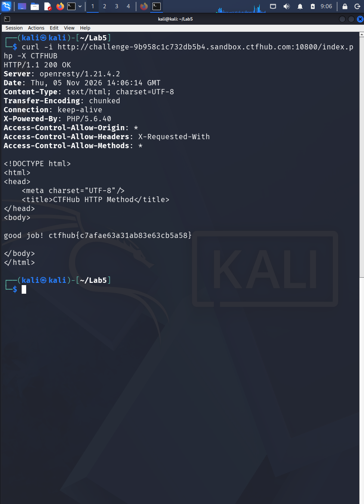

# WP：请求方式

> **CTFHub 路径**：技能树 → Web → Web 前置技能 → HTTP 协议 → 请求方式
> **任务**：按题目要求使用指定的 HTTP 方法访问目标，拿到 flag。
> **提示**：浏览器地址栏默认发送 GET 请求。用 Burp Repeater 修改请求行中的方法，或者用 `curl -X` 复现。
> **截图要求**：优先使用 Burp Repeater，截图中要能看到修改后的请求行（方法 + 路径）和响应中的 flag；如果 Burp 无法启动，可以用 `curl -X` 的方法修改截图代替，并在 WP 中说明原因。只有浏览器普通 GET 访问不算完成。

---

## 题目信息

| 项目 | 内容 |
| --- | --- |
| 环境地址 | http://challenge-9b958c1c732db5b4.sandbox.ctfhub.com:10800 |
| Flag | ctfhub{c7afae63a31ab83e63cb5a58} |

## 解题过程

浏览器打开环境地址，页面提示「HTTP Method is GET」，下一行写着「Use CTF\*\*B Method, I will give you flag」，还给了 Hint：如果遇到 HTTP Method Not Allowed，就请求 `index.php`。我先试着对根路径 `/` 用 `CTFHUB` 方法请求，果然被 nginx 挡回来 405 Not Allowed，这和题目 Hint 对上了。于是改用 `index.php` 作为请求路径，在 Kali 终端里用 `curl -X CTFHUB` 发请求，响应体里直接返回 `good job!` 加 flag。这里我用 `curl -X` 而不是 Burp Repeater，因为本题只需要改请求行里的方法名，curl 一条命令就能完整复现并留下证据（截图里 request line 与响应都在同一屏）。

## 关键请求/响应

```http
CTFHUB /index.php HTTP/1.1
Host: challenge-9b958c1c732db5b4.sandbox.ctfhub.com:10800
User-Agent: curl/8.5.0

HTTP/1.1 405 Not Allowed          （先对 / 用 CTFHUB 时，被 nginx 拒绝）
Server: nginx/1.14.2

CTFHUB /index.php HTTP/1.1
Host: challenge-9b958c1c732db5b4.sandbox.ctfhub.com:10800
User-Agent: curl/8.5.0

HTTP/1.1 200 OK
Server: openresty/1.21.4.2
Content-Type: text/html; charset=UTF-8
X-Powered-By: PHP/5.6.40

<title>CTFHub HTTP Method</title>
<body>
good job! ctfhub{c7afae63a31ab83e63cb5a58}
</body>
```

## 原理与复盘

请求行由三部分组成：**方法 + 请求路径 + HTTP 版本**，方法就写在最前面（例如 `CTFHUB /index.php HTTP/1.1`）。HTTP/1.1 里虽然只定义了 GET、POST、PUT、DELETE 等八种标准方法，但服务器完全可以用自己的代码去判断任意方法名，所以本题把"方法"当成了口令来用。这也说明方法名不是给浏览器"规定"的，抓包改掉它服务器就认——Burp、curl `-X` 都是干这件事。

---

## 截图



> 可以在这份 WP 中另加过程截图；检查时只看指定图片，额外图片不检查。
