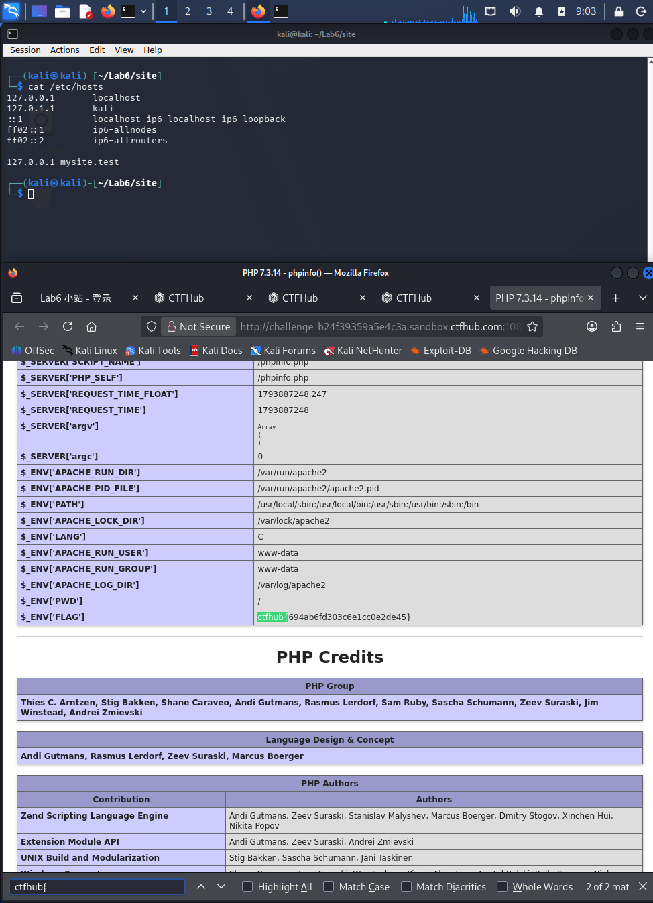

# WP：PHPINFO

> **CTFHub 路径**：技能树 → Web → 信息泄露 → PHPINFO
> **任务**：在 phpinfo 页面中找到 flag，并观察它泄露了哪些信息。
> **提示**：phpinfo 会输出大量 PHP 和服务器配置。用浏览器的查找功能搜索关键字，同时留意页面暴露的路径、版本、环境变量等信息。
> **截图要求**：能看到 phpinfo 页面、你搜索/定位到的 flag，以及至少一处敏感信息。

---

## 题目信息

| 项目 | 内容 |
| --- | --- |
| 环境地址 | http://challenge-b24f39359a5e4c3a.sandbox.ctfhub.com:10800/phpinfo.php |
| Flag | ctfhub{694ab6fd303c6e1cc0e2de45} |

## 解题过程

题目首页只有一句「点击查看 phpinfo」，点进去是标准的 `phpinfo()` 输出页面，长得几乎翻不到底。我一开始先往下滑了几屏，看到 PHP 7.3.14、Apache 2.0 Handler、配置文件路径 `/usr/local/etc/php/php.ini` 这些信息，但没看到 flag。后来用浏览器查找（Ctrl+F）搜 `ctfhub{`，页面直接跳到 `$_ENV['FLAG']` 那一行，flag 就写在值里；同一块还能看到 `APACHE_RUN_USER=www-data`、`DOCUMENT_ROOT` 等环境变量。为了留证据，我截图时把查找框和地址栏一起留在画面里，并在终端用 `curl` 抓了一次页面确认源码里确实是这串字符。

## 关键请求/响应

```http
GET /phpinfo.php HTTP/1.1
Host: challenge-b24f39359a5e4c3a.sandbox.ctfhub.com:10800
User-Agent: Mozilla/5.0 (X11; Linux x86_64; rv:140.0) Gecko/20100101 Firefox/140.0

HTTP/1.1 200 OK
Server: openresty/1.21.4.2
Content-Type: text/html; charset=UTF-8
X-Powered-By: PHP/5.6.40

<tr><td class="e">System </td><td class="v">Linux challenge-b24f39359a5e4c3a-48658... #1 SMP PREEMPT_DYNAMIC Debian 6.12.48+deb13-amd64 x86_64</td></tr>
<tr><td class="e">PHP Version </td><td class="v">7.3.14</td></tr>
<tr><td class="e">Loaded Configuration File </td><td class="v">/usr/local/etc/php/php.ini</td></tr>
<tr><td class="e">APACHE_RUN_USER </td><td class="v">www-data</td></tr>
<tr><td class="e">$_ENV['FLAG'] </td><td class="v">ctfhub{694ab6fd303c6e1cc0e2de45}</td></tr>
```

## 原理与复盘

phpinfo 相当于把**响应体**当"体检报告"输出：PHP 版本、编译参数、扩展、配置文件绝对路径、环境变量、请求头全部摊开，攻击者据此可以挑对应版本的漏洞、找到可写的配置目录，或者直接读到本该只在服务端的环境变量。这题 flag 就藏在 `$_ENV['FLAG']` 里，说明"把敏感值放进环境变量却忘了关掉调试页面"是典型的泄露路径。所以 phpinfo 页面只应临时用于内网排错，上线必须删掉或加访问控制。

---

## 截图



> 可以在这份 WP 中另加过程截图；检查时只看指定图片，额外图片不检查。
