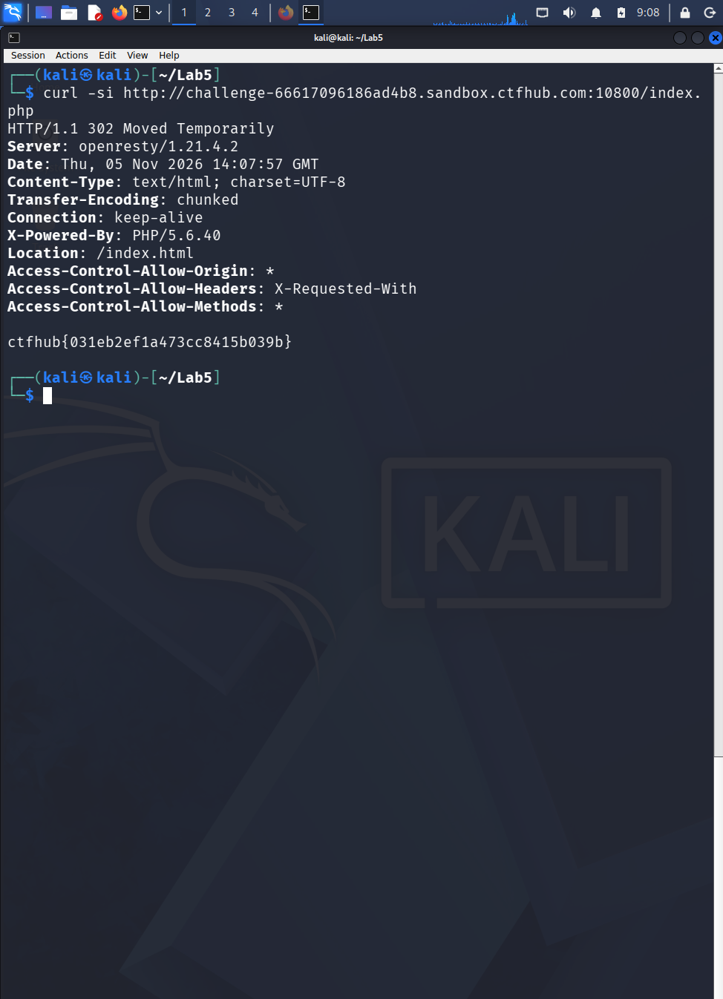

# WP：302 跳转

> **CTFHub 路径**：技能树 → Web → Web 前置技能 → HTTP 协议 → 302 跳转
> **任务**：观察 302 重定向，按题目提示找到 flag。
> **提示**：浏览器通常会自动跟随 302，所以你可能只看到最终页面。打开 DevTools 的 Network 面板（勾选 Preserve log）或 Burp，查看原始响应中的 `302` 状态码和 `Location` 响应头。
> **截图要求**：能看到 302 状态码和/或 `Location` 响应头，以及最终的 flag。只截最终页面、没有 302 证据的截图不合格。

---

## 题目信息

| 项目 | 内容 |
| --- | --- |
| 环境地址 | http://challenge-66617096186ad4b8.sandbox.ctfhub.com:10800 |
| Flag | ctfhub{031eb2ef1a473cc8415b039b} |

## 解题过程

第一次访问根路径只看到「No Flag here!」外加一个「Give me Flag」链接，点进去浏览器直接变成 index.html 的内容，页面上还是「No Flag here!」，完全看不到 flag。我意识到浏览器把中间的 302 自动跟完了，于是改用 `curl -si` 直接请求 `index.php`，不跟随跳转。这次响应头部是 `HTTP/1.1 302 Moved Temporarily`、`Location: /index.html`，而在 302 响应的**响应体**里就躺着 flag。也就是说 flag 放在重定向那一跳的 body 里，只有不自动跟随才看得到。

## 关键请求/响应

```http
GET /index.php HTTP/1.1
Host: challenge-66617096186ad4b8.sandbox.ctfhub.com:10800
User-Agent: curl/8.5.0

HTTP/1.1 302 Moved Temporarily
Server: openresty/1.21.4.2
Content-Type: text/html; charset=UTF-8
X-Powered-By: PHP/5.6.40
Location: /index.html

ctfhub{031eb2ef1a473cc8415b039b}
```

## 原理与复盘

302 是"临时重定向"：状态行告诉你"东西不在这，去 Location 指的地址拿"，浏览器看到 3xx + Location 会自动再发一次请求，用户在地址栏里几乎无感。200 则是直接把当前资源返回，浏览器不跳。所以这道题的关键是**不要跟随跳转**（curl 不加 `-L`、Burp 看原始响应、DevTools 勾 Preserve log），否则只会看到第二跳的页面，而第一跳响应体里的 flag 就被丢掉了。

---

## 截图



> 可以在这份 WP 中另加过程截图；检查时只看指定图片，额外图片不检查。
