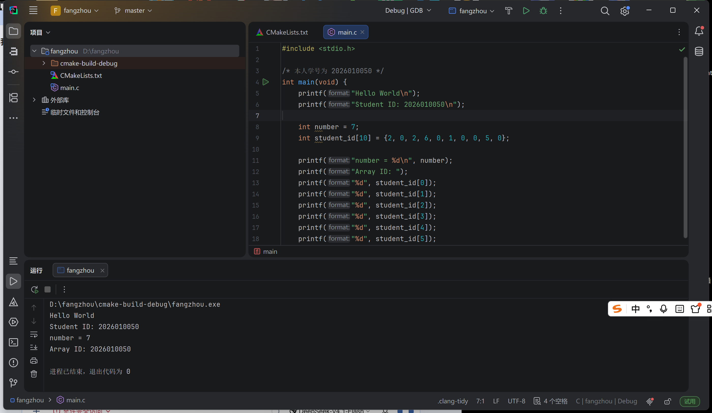
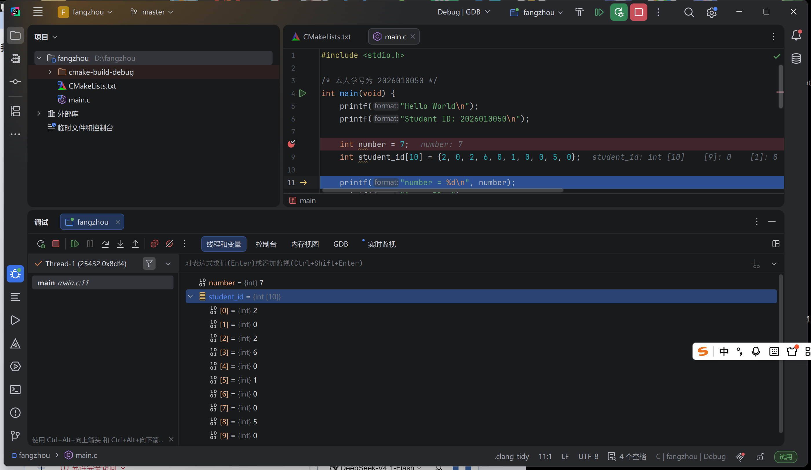

# Lab7：使用 CLion 完成 C 程序输出与断点调试

> **实验目标**：在 Windows 本机使用 CLion 建立并运行 C 程序，完成文字输出、整数变量输出、学号数组定义和固定下标访问，最后使用断点和单步执行观察变量值。
>
> **先修要求**：本实验面向 C 语言零基础学生。按照六项任务逐步修改同一个 `main.c`，每完成一项运行一次，确认结果后再继续。
>
> **学习重点**：能够说明程序当前执行到哪条语句、变量保存什么值，以及数组下标对应学号中的哪一位数字。本次调试只使用源码高亮位置和 Variables 面板。

## 一、实验任务与提交内容

| 顺序 | 任务 | 完成标志 |
| :---: | :--- | :--- |
| 1 | 使用 CLion 输出 Hello World | Run 窗口显示 `Hello World` |
| 2 | 输出本人学号 | 使用一条 `printf` 输出完整的 10 位学号 |
| 3 | 定义并输出一个 `int` 变量 | 输出变量保存的整数 |
| 4 | 定义由学号数字构成的数组 | 10 个数组元素分别对应学号的 10 位数字 |
| 5 | 手写固定下标，依次输出数组元素 | 用十条输出语句按顺序输出学号，不使用循环 |
| 6 | 使用 CLion 断点调试 | 程序在断点处暂停，能查看变量和数组，并完成单步执行 |

六项任务在同一个项目中依次完成。最终程序应保留前五项的全部输出，第六项直接调试该程序。

本地材料如下：

```text
homework/Lab7/
├── Lab7.md          实验说明与报告模板
├── lab7_basics.c     最终程序示例，供完成任务后核对
└── TEACHING.md      教师备课说明
```

最终提交 **`Lab7.md`、`lab7_basics.c` 和两张截图，共 4 个文件**。源码须为本人完成六项任务后实际运行和调试的最终版本，截图分别记录运行结果和调试状态。具体目录见第五节。

## 二、建立 CLion 项目

### 2.1 安装与创建项目

1. 从 [CLion 官网](https://www.jetbrains.com/clion/download/) 下载 Windows 安装程序并完成安装。
2. 使用 Lab4 申请的 JetBrains 学生账号完成授权；已有有效授权也可使用。
3. 在 CLion 中选择 **New Project → C Executable**。
4. 项目名可设为 `Lab7_clion`，语言标准选择 **C11**。
5. 将项目放在课程仓库之外，例如 `D:\course\Lab7_clion`，点击 **Create**。

项目创建后应包含 `main.c` 和自动生成的 `CMakeLists.txt`。本次只编辑 `main.c`，保留自动生成的构建配置即可。

若自动生成的是 `main.cpp`，说明选择了 C++ 项目，应重新选择 **C Executable**。

### 2.2 确认运行与调试配置

1. 打开 **File → Settings → Build, Execution, Deployment → Toolchains**。
2. 确认使用 MinGW 工具链，工具集选择 **Bundled MinGW**，等待相关工具检测完成。
3. 打开 **Build, Execution, Deployment → CMake**，确认当前配置的 **Build type** 为 **Debug**。
4. 应用设置，等待项目加载完成。

本次使用 CLion 提供的内置工具即可。配置界面可参考 [CLion Windows 工具链说明](https://www.jetbrains.com/help/clion/quick-tutorial-on-configuring-clion-on-windows.html)。

Build type 为 Debug 是调试前的准备设置。后续点击 **Run** 时程序正常运行；点击 **Debug** 时才能使用断点和单步操作。

## 三、实验步骤

### 3.1 任务一：输出 Hello World

将 `main.c` 中自动生成的内容替换为：

```c
#include <stdio.h>

int main(void) {
    printf("Hello World\n");
    return 0;
}
```

保存文件，点击 **Run**，或使用默认快捷键 `Shift+F10`。CLion 会构建并运行程序，Run 窗口应显示：

```text
Hello World
```

先理解以下几处写法即可：

| 代码 | 本次需要理解的含义 |
| :--- | :--- |
| `#include <stdio.h>` | 为使用 `printf` 提供所需声明，保留在文件开头 |
| `int main(void)` | 程序入口，本次编写的执行语句放在其大括号内 |
| `printf("Hello World\n");` | 输出引号中的文字，其中 `\n` 表示换行 |
| `return 0;` | 结束程序，表示正常完成；它不会输出数字 `0` |

`printf` 中的文字必须放在英文双引号内，语句末尾使用英文分号。输入中文引号或中文分号会导致构建错误。

运行窗口可能还包含程序路径和进程结束信息，这些是 CLion 的提示。本任务需要核对的是程序实际输出的 `Hello World`。

### 3.2 任务二：输出本人学号

在 Hello World 输出语句之后、`return 0;` 之前增加一条语句：

```c
printf("Student ID: 2026010099\n");
```

`2026010099` 是教师示例学号，必须替换为本人的 10 位学号。此处将学号作为引号内的文字输出，逐位核对即可。

修改后的执行顺序是先输出 Hello World，再输出学号。运行结果应为两行，例如：

```text
Hello World
Student ID: 2026010099
```

`Student ID: ` 是固定文字，冒号后的学号也是这条语句中直接写入的文字。此时还没有定义保存学号的变量或数组。

### 3.3 任务三：定义并输出整数变量

在两条输出语句之后、`return 0;` 之前增加：

```c
int number = 7;
printf("number = %d\n", number);
```

`int number = 7;` 定义一个名为 `number` 的整数变量，并将初始值设为 `7`。可以将初始值改为其他较小的整数，报告和截图记录本人实际值即可。

第二条语句输出该变量的值：

- 引号内的 `number = ` 是固定文字。
- `%d` 表示此处需要输出一个十进制整数。
- 引号外、逗号后的 `number` 指定需要读取的变量。
- `\n` 使后续输出从新的一行开始。

当变量值为 `7` 时，输出为：

```text
number = 7
```

这里应使用 `%d` 与变量名输出实际变量值。若直接写 `printf("number = 7\n");`，输出的是固定文字，不能证明程序读取了变量。

**初始化与执行顺序。** 定义变量时设置初始值称为初始化。源码写有 `int number = 7;`，并不表示程序运行中的任何时刻都已经执行了它；只有该语句执行完成后，才能读取本次初始化的结果。任务六将通过断点观察这一顺序。

### 3.4 任务四：定义学号数组

在 `int number = 7;` 后面增加学号数组定义。以示例学号 `2026010099` 为例：

```c
int student_id[10] = {2, 0, 2, 6, 0, 1, 0, 0, 9, 9};
```

数组用于按顺序保存多个同类型的数据。这里需要保存 10 位学号，所以定义 10 个 `int` 元素，每个元素保存一位数字。

| 组成部分 | 含义 |
| :--- | :--- |
| `int` | 每个元素保存一个整数 |
| `student_id` | 数组名称 |
| 定义中的 `[10]` | 数组包含 10 个元素 |
| `{2, 0, 2, 6, 0, 1, 0, 0, 9, 9}` | 从左到右排列的 10 个初始值，用英文逗号分隔 |

按本人的学号替换大括号内的数字。每个数字独立填写，学号中的 `0` 也必须保留，不能将整个学号写成一个数组元素。

数组中的位置通过**下标**区分。下标从 `0` 开始，学号第 1 位对应下标 `0`，第 10 位对应下标 `9`：

| 学号中的位置 | 访问表达式 | 示例中的数字 |
| :---: | :--- | :---: |
| 第 1 位 | `student_id[0]` | 2 |
| 第 2 位 | `student_id[1]` | 0 |
| 第 3 位 | `student_id[2]` | 2 |
| 第 4 位 | `student_id[3]` | 6 |
| 第 5 位 | `student_id[4]` | 0 |
| 第 6 位 | `student_id[5]` | 1 |
| 第 7 位 | `student_id[6]` | 0 |
| 第 8 位 | `student_id[7]` | 0 |
| 第 9 位 | `student_id[8]` | 9 |
| 第 10 位 | `student_id[9]` | 9 |

注意定义与访问的区别：定义中的 `[10]` 表示元素数量；使用 `student_id[9]` 才是在访问第 10 个元素。本实验只使用 `0` 至 `9` 这十个下标。

新增数组定义后运行程序，输出不会因此自动增加。定义数组只是准备数据，下一项任务才输出这些数据。

### 3.5 任务五：手写固定下标，依次输出学号数字

在输出 `number` 的语句之后、`return 0;` 之前增加以下语句：

```c
printf("Array ID: ");
printf("%d", student_id[0]);
printf("%d", student_id[1]);
printf("%d", student_id[2]);
printf("%d", student_id[3]);
printf("%d", student_id[4]);
printf("%d", student_id[5]);
printf("%d", student_id[6]);
printf("%d", student_id[7]);
printf("%d", student_id[8]);
printf("%d", student_id[9]);
printf("\n");
```

本次采用最直接的方式：手写十条语句，每条读取一个固定下标处的元素，然后输出这个整数。不使用循环，也不将十个数组元素合并到一条输出语句中。

以 `printf("%d", student_id[3]);` 为例：先读取下标 `3` 的元素，即学号第 4 位，再用 `%d` 输出该整数。示例中这一位是 `6`。

十条数字输出语句都没有写 `\n`，因此数字会依次连接在同一行。最后单独执行 `printf("\n");`，才结束这一行。

运行后检查：

1. `Array ID: ` 后面是否恰好出现十位数字。
2. 数字顺序是否与本人学号一致。
3. 第二行直接输出的学号与最后一行从数组输出的学号是否相同。

若出现数字缺失、重复或顺序错误，先检查数组中的十个初始值，再检查十条输出语句是否按 `0` 至 `9` 顺序各写一次。

#### 最终程序核对

以下为任务一至五完成后的程序示例，也可在 [lab7_basics.c](lab7_basics.c) 中查看。应先逐项完成任务，再使用示例核对结构。示例学号需要在文字输出和数组定义两处分别替换。

```c
#include <stdio.h>

/* 示例学号为 2026010099。练习时替换字符串和数组中的学号。 */
int main(void) {
    printf("Hello World\n");
    printf("Student ID: 2026010099\n");

    int number = 7;
    int student_id[10] = {2, 0, 2, 6, 0, 1, 0, 0, 9, 9};

    printf("number = %d\n", number);
    printf("Array ID: ");
    printf("%d", student_id[0]);
    printf("%d", student_id[1]);
    printf("%d", student_id[2]);
    printf("%d", student_id[3]);
    printf("%d", student_id[4]);
    printf("%d", student_id[5]);
    printf("%d", student_id[6]);
    printf("%d", student_id[7]);
    printf("%d", student_id[8]);
    printf("%d", student_id[9]);
    printf("\n");

    return 0;
}
```

使用示例数据时，程序输出如下：

```text
Hello World
Student ID: 2026010099
number = 7
Array ID: 2026010099
```

完成个人数据替换并确认运行结果后，保存 `imgs/lab7_run.png`。截图应能看到 CLion 中的源码及 Run 窗口的四行输出。

### 3.6 任务六：使用断点与单步调试

本任务只观察当前执行位置、整数变量和数组元素。使用任务五完成后的程序，保持源码已保存、Build type 为 Debug。

#### 3.6.1 设置断点并启动 Debug

1. 在 `int number = 7;` 所在行的行号旁单击，确认出现断点标记。如果修改过初始值，选择对应的定义行即可。
2. 点击 **Debug**，或按默认快捷键 `Shift+F9`。
3. 等待程序在该行暂停，确认出现当前执行位置的高亮标记。
4. 打开 Debug 工具窗口中的 **Variables** 面板。

断点标记表示要求程序在该位置暂停；高亮的当前行表示本次运行实际暂停的位置。只有红色断点标记、程序尚未启动或未暂停，不能作为完成调试的证据。

此时，前面的 Hello World 和学号输出语句已经执行，`number` 的初始化尚未完成。Variables 可能暂不显示 `number`，也可能显示一个已有数值；这些都不能作为本次初始化的结果。

#### 3.6.2 使用 Step Over 观察初始化

1. 执行一次 **Step Over**，默认快捷键为 `F8`，使 `number` 的初始化完成。
2. 检查当前高亮行是否已到达数组定义处，在 Variables 中确认 `number` 显示源码中设置的初始值。
3. 再执行 **Step Over**，使数组初始化完成，当前位置应到达 `printf("number = %d\n", number);`。
4. 在 Variables 中展开 `student_id`，逐项核对下标 `0` 至 `9` 的值是否对应本人学号。

本程序每条语句分别占一行，适合按上述顺序观察。如果实际暂停位置与示例不同，应先核对高亮行，确认相应初始化是否已完成，再读取变量值。

此时保存 `imgs/lab7_debug.png`。截图应同时包含源码、暂停位置、`number` 的实际值和展开后的学号数组。可适当调整 Variables 面板的高度，显示十个元素。

#### 3.6.3 单步执行输出语句

继续使用 **Step Over**，观察高亮位置从一条 `printf` 移动到下一条。当需要查看输出时，可切换到调试会话的 Console 面板。

Step Over 会执行当前语句，然后在后续位置暂停。对本次的 `printf` 调用，它用于完成输出并继续查看下一条源码语句，不需要进入输出函数内部。

逐条输出数字的过程中，Console 可能暂时没有显示完整的一行。这不影响以高亮位置和 Variables 判断执行状态；执行到最后的换行语句并继续运行后，再核对完整输出，不将控制台立即刷新作为验收条件。

最后点击 **Resume Program**，或按 `F9`，使程序继续运行至结束。若需要重新观察，重新启动 Debug；若需要终止当前会话，使用 Stop。

| 操作 | 默认 Windows 快捷键 | 本次用途 |
| :--- | :--- | :--- |
| Run | `Shift+F10` | 正常运行并核对完整输出 |
| Debug | `Shift+F9` | 启动调试，在断点处暂停 |
| Step Over | `F8` | 执行当前语句，观察下一处执行位置和变量值 |
| Resume Program | `F9` | 继续运行到后续断点或程序结束 |
| Stop | `Ctrl+F2` | 终止当前调试会话 |

快捷键受 Keymap 或个人设置影响；若与本文不同，使用工具栏中的同名按钮即可。

## 四、实验报告

保留模板中的说明、代码示例、表格与图片引用，仅替换指定填写位置。报告和截图应来自本人实际操作；本文中的示例学号保留在示例中，不能作为本人填写内容。

### 4.1 基本信息

| 项目 | 本人记录 |
| :--- | :--- |
| 姓名 | 方舟 |
| 10 位学号 | 2026010050 |
| Windows 版本 | Windows 11 25H2（版本号 10.0.26200.6899） |
| CLion 版本 | CLion 2026.3 |

### 4.2 程序运行记录

粘贴本人最终程序的完整四行输出：

```text
Hello World
Student ID: 2026010050
number = 7
Array ID: 2026010050
```

填写本人使用的变量与数组数据：

| 项目 | 本人记录 |
| :--- | :--- |
| `int` 变量名称及初始值 | `number`，初始值 `7` |
| 学号数组名称及十个初始值，按顺序用逗号分隔 | `student_id`，`2, 0, 2, 6, 0, 1, 0, 0, 5, 0` |
| 直接输出的学号与数组输出的学号是否一致 | 一致，均为 `2026010050` |

### 4.3 调试观察记录

| 观察项目 | 本人记录 |
| :--- | :--- |
| 设置断点的源码语句 | `int number = 7;` |
| 整数变量初始化完成后的高亮语句及变量值 | 高亮语句为 `int student_id[10] = {2, 0, 2, 6, 0, 1, 0, 0, 5, 0};`，此时 Variables 中 `number` 的值为 `7` |
| 数组初始化完成后，下标 `0` 和下标 `9` 的值 | `student_id[0]` 为 `2`，`student_id[9]` 为 `0` |
| 对一条 `printf` 执行 Step Over 前后的高亮语句 | Step Over 前高亮 `printf("number = %d\n", number);`，Step Over 后高亮 `printf("Array ID: ");` |

记录高亮语句时填写实际源码内容即可，不要求固定行号。数组元素和整数变量值应在对应初始化完成后记录。

### 4.4 简要说明

每题用一到两句话，结合本次操作回答：

1. `printf("7\n");` 与 `printf("%d\n", number);` 分别从哪里取得输出内容？

   > `printf("7\n");` 的输出内容来自引号中直接写死的文字 `7`，与变量无关；`printf("%d\n", number);` 中的 `%d` 是占位符，输出内容来自引号外逗号后的变量 `number` 当时保存的值。

2. 学号数组有十个元素，为什么输出时使用下标 `0` 至 `9`？下标 `3` 对应学号第几位？

   > C 语言数组下标从 `0` 开始计数，十个元素的下标依次是 `0` 到 `9`，所以访问第一位用 `student_id[0]`、最后一位用 `student_id[9]`。下标 `3` 对应学号的第 4 位数字，本次为 `6`。

3. 首次暂停在 `int number = 7;` 时，为什么需要执行 Step Over 后再记录变量的初始值？如果使用了其他变量名或初始值，按本人的代码说明即可。

   > 断点在 `int number = 7;` 处暂停时，这条初始化语句还没有执行，`number` 里还没有本次初始化的结果。执行一次 Step Over 让该语句执行完毕，Variables 中显示的值才是本次初始化的 `7`。

### 4.5 实验截图

| 文件 | 必须能够辨认的内容 |
| :--- | :--- |
| `imgs/lab7_run.png` | CLion 中的 C 源码及完整四行运行输出；直接输出与数组输出均为本人学号 |
| `imgs/lab7_debug.png` | CLion 中命中断点或单步后的暂停位置、Variables 中整数变量的值及展开的十个数组元素 |

运行截图中的源码区域应能辨认十条固定下标输出语句；调试截图中的数组元素应与本人学号逐位对应。截图不要求固定主题、面板布局或整数变量初始值。





## 五、截图与提交

使用 Windows 自带截图工具（`Win + Shift + S`）保存图片，不使用手机拍摄屏幕。

完成实验后，将 CLion 项目中实际运行和调试的 `main.c` 复制到个人作业目录，并将副本命名为 `lab7_basics.c`。项目内继续保留 `main.c`，无需修改构建配置。提交的源码应包含本人学号和对应的十个数组元素，不能直接提交尚未替换示例学号的教师文件。

提交目录如下：

```text
学号姓名/
└── Lab7/
    ├── Lab7.md
    ├── lab7_basics.c
    └── imgs/
        ├── lab7_run.png
        └── lab7_debug.png
```

提交前检查：

- 第四节所有填写位置均已完成，报告中的学号、数组数据与截图一致。
- 两张图片均为 PNG 格式，单张不超过 5 MB，文字和数值可辨认。
- 图片能在 Markdown 预览中正常显示。
- `lab7_basics.c` 的代码、报告记录与两张截图相互对应，文件名使用上述固定写法。
- 本次只提交上述四个文件，不提交 CLion 项目、`.idea`、`cmake-build-debug`、`CMakeLists.txt`、编译产物或压缩包。

PR 标题为 `[学号姓名]Lab7作业提交`，右方括号后不留空格；一个 PR 只包含本人的本次 Lab7 文件。

## 六、截止时间

**2026 年 11 月 13 日 24:00（即 2026 年 11 月 14 日 00:00，北京时间）**

以 GitHub 记录的最后一次向 PR 推送的时间为准。截止之后新建 PR 或继续推送修改均按超时处理。

## 七、常见问题

| 现象 | 检查与处理 |
| :--- | :--- |
| 项目中只有 `main.cpp` | 重新创建 C Executable 项目，编辑 `main.c` |
| 构建失败 | 检查英文引号、分号、大括号是否完整，变量名是否一致；先处理构建窗口中的第一条错误 |
| 修改学号后仍显示示例数据 | 文字输出和数组定义需要分别修改；保存后重新构建并运行 |
| 数组输出缺位、重复或顺序错误 | 核对十个初始值，再核对输出下标是否按 `0` 至 `9` 各出现一次 |
| 学号数字分别出现在多行 | 删除十条数字输出语句中的 `\n`，只在十个数字输出结束后换行 |
| 输出的整数没有随变量修改而改变 | 确认使用 `%d` 和变量名，且新源码构建成功；不要将固定文字或历史输出作为结果 |
| 程序没有在断点暂停 | 确认使用 Debug，断点设置在会执行的语句上，Build type 为 Debug |
| Variables 中数值不符合预期 | 核对暂停位置，确认变量或数组初始化已经执行完成 |
| 数组只显示一行摘要 | 点击 Variables 中数组名称左侧的展开箭头，查看十个元素 |
| 单步输出数字时控制台暂未更新 | 继续执行至换行语句，必要时 Resume 至程序结束后核对完整输出 |
